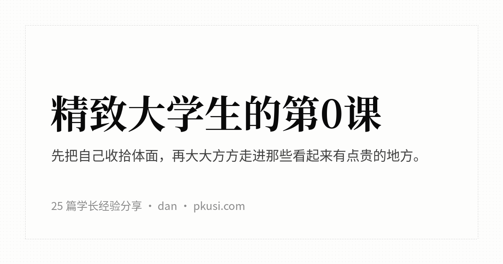

# 精致大学生的第0课

[](https://chuxainpei.github.io/how-to-be-yuppie/)

给刚来大城市的你：把自己收拾体面，再大大方方走进去。

25 篇经验分享，分四部分。每篇先给我的态度，再告诉你第一次去该怎么开口、钱花在哪、什么别碰。

### [在线阅读](https://chuxainpei.github.io/how-to-be-yuppie/)

| | |
|---|---|
| **下载** | [PDF](https://pkusi.com/yuppie/download/how-to-be-yuppie.pdf) · [离线单文件（HTML）](https://pkusi.com/yuppie/download/how-to-be-yuppie.html)（国内直连）· 备用：[GitHub Release](https://github.com/chuxainpei/how-to-be-yuppie/releases/tag/latest) |
| **反馈** | 写错了、过时了、店关了，[提 issue](https://github.com/chuxainpei/how-to-be-yuppie/issues) |

在线阅读页手机、电脑都能用：电脑上左边是全书目录、右边是本篇大纲；手机上目录收进抽屉（点左上角或从屏幕左缘右滑），底部有翻页条。都支持全文搜索（按 `/`）、调字号、深浅色，会记住你读到哪一篇的哪个位置。

## 目录

- [写在前面](book/前言.md)

## 把自己收拾体面

- [刷牙：毛病多半出在牙缝](book/1-%E6%8A%8A%E8%87%AA%E5%B7%B1%E6%94%B6%E6%8B%BE%E4%BD%93%E9%9D%A2/%E5%88%B7%E7%89%99.md)
- [洗牙：别怕，每年去一次](book/1-%E6%8A%8A%E8%87%AA%E5%B7%B1%E6%94%B6%E6%8B%BE%E4%BD%93%E9%9D%A2/%E6%B4%97%E7%89%99.md)
- [蛀牙：越拖越贵，别等它疼](book/1-%E6%8A%8A%E8%87%AA%E5%B7%B1%E6%94%B6%E6%8B%BE%E4%BD%93%E9%9D%A2/%E8%9B%80%E7%89%99.md)
- [牙不齐不白：先正畸，贴面排最后](book/1-%E6%8A%8A%E8%87%AA%E5%B7%B1%E6%94%B6%E6%8B%BE%E4%BD%93%E9%9D%A2/%E6%AD%A3%E7%95%B8%E4%B8%8E%E8%B4%B4%E9%9D%A2.md)
- [配眼镜：钱花在验光上，别花在镜框上](book/1-%E6%8A%8A%E8%87%AA%E5%B7%B1%E6%94%B6%E6%8B%BE%E4%BD%93%E9%9D%A2/%E9%85%8D%E7%9C%BC%E9%95%9C.md)
- [隐形眼镜：日抛最省心，OK镜多半不是给你的](book/1-%E6%8A%8A%E8%87%AA%E5%B7%B1%E6%94%B6%E6%8B%BE%E4%BD%93%E9%9D%A2/%E9%9A%90%E5%BD%A2%E7%9C%BC%E9%95%9C.md)
- [近视手术：想清楚就去做，全飞秒不是唯一答案](book/1-%E6%8A%8A%E8%87%AA%E5%B7%B1%E6%94%B6%E6%8B%BE%E4%BD%93%E9%9D%A2/%E8%BF%91%E8%A7%86%E6%89%8B%E6%9C%AF.md)
- [护肤：洗脸、保湿、防晒，三样就够](book/1-%E6%8A%8A%E8%87%AA%E5%B7%B1%E6%94%B6%E6%8B%BE%E4%BD%93%E9%9D%A2/%E6%8A%A4%E8%82%A4.md)
- [痘痘：三个月不见好，就去皮肤科](book/1-%E6%8A%8A%E8%87%AA%E5%B7%B1%E6%94%B6%E6%8B%BE%E4%BD%93%E9%9D%A2/%E7%97%98%E7%97%98.md)
- [理发：说不清要什么，别怪理发师](book/1-%E6%8A%8A%E8%87%AA%E5%B7%B1%E6%94%B6%E6%8B%BE%E4%BD%93%E9%9D%A2/%E7%90%86%E5%8F%91.md)
- [染发和烫发：先问代价，再谈好看](book/1-%E6%8A%8A%E8%87%AA%E5%B7%B1%E6%94%B6%E6%8B%BE%E4%BD%93%E9%9D%A2/%E6%9F%93%E5%8F%91%E7%83%AB%E5%8F%91.md)
- [健身：为了好看去练，别为了脱单](book/1-%E6%8A%8A%E8%87%AA%E5%B7%B1%E6%94%B6%E6%8B%BE%E4%BD%93%E9%9D%A2/%E5%81%A5%E8%BA%AB.md)

## 吃得明白

- [西餐厅和酒店下午茶：怕的不是刀叉，是账单](book/2-%E5%90%83%E5%BE%97%E6%98%8E%E7%99%BD/%E8%A5%BF%E9%A4%90%E4%B8%8E%E4%B8%8B%E5%8D%88%E8%8C%B6.md)
- [高档中餐：会点菜，比会喝酒重要](book/2-%E5%90%83%E5%BE%97%E6%98%8E%E7%99%BD/%E9%AB%98%E6%A1%A3%E4%B8%AD%E9%A4%90.md)
- [Omakase：坐下来，把选择权交给师傅](book/2-%E5%90%83%E5%BE%97%E6%98%8E%E7%99%BD/Omakase.md)
- [咖啡馆和茶馆：说出口味，比背名词有用](book/2-%E5%90%83%E5%BE%97%E6%98%8E%E7%99%BD/%E5%92%96%E5%95%A1%E9%A6%86%E4%B8%8E%E8%8C%B6%E9%A6%86.md)
- [同一顿饭少花钱：团购先比价，二手券要小心](book/2-%E5%90%83%E5%BE%97%E6%98%8E%E7%99%BD/%E5%90%83%E9%A5%AD%E7%9C%81%E9%92%B1.md)

## 出门玩

- [酒吧：不懂酒，就按口味点](book/3-%E5%87%BA%E9%97%A8%E7%8E%A9/%E9%85%92%E5%90%A7.md)
- [Livehouse：票买完，准备才开始](book/3-%E5%87%BA%E9%97%A8%E7%8E%A9/Livehouse.md)
- [剧院和音乐厅：守住几条规矩就够了](book/3-%E5%87%BA%E9%97%A8%E7%8E%A9/%E5%89%A7%E9%99%A2%E4%B8%8E%E9%9F%B3%E4%B9%90%E5%8E%85.md)
- [美术馆和画廊：看不懂也尽管进](book/3-%E5%87%BA%E9%97%A8%E7%8E%A9/%E7%BE%8E%E6%9C%AF%E9%A6%86%E4%B8%8E%E7%94%BB%E5%BB%8A.md)
- [按摩和洗浴：不舒服就喊停](book/3-%E5%87%BA%E9%97%A8%E7%8E%A9/%E6%8C%89%E6%91%A9%E4%B8%8E%E6%B4%97%E6%B5%B4.md)

## 逛店不怯场

- [奢侈品店：只看不买，没人有资格给你脸色](book/4-%E9%80%9B%E5%BA%97%E4%B8%8D%E6%80%AF%E5%9C%BA/%E5%A5%A2%E4%BE%88%E5%93%81%E5%BA%97.md)
- [认识奢侈品牌：先认招牌，再谈派系](book/4-%E9%80%9B%E5%BA%97%E4%B8%8D%E6%80%AF%E5%9C%BA/%E5%A5%A2%E4%BE%88%E5%93%81%E7%89%8C.md)
- [运动和户外品牌：按用途买，别按标志买](book/4-%E9%80%9B%E5%BA%97%E4%B8%8D%E6%80%AF%E5%9C%BA/%E8%BF%90%E5%8A%A8%E6%88%B7%E5%A4%96%E5%93%81%E7%89%8C.md)

## 怎么读

- **在线**：打开 [在线阅读页](https://chuxainpei.github.io/how-to-be-yuppie/)。页面直接读取本仓库 `book/` 里的 Markdown，正文一改，页面跟着改。
- **离线、发给别人**：下载 [离线单文件](https://pkusi.com/yuppie/download/how-to-be-yuppie.html)，整本书连同插图、搜索都在一个文件里，双击就开，微信里也能直接传。
- **打印或在平板上翻**：下载 [PDF](https://pkusi.com/yuppie/download/how-to-be-yuppie.pdf)，A4 排版，带目录和书签。
- 这两样下载在每次正文更新后由 GitHub Actions 自动重新生成，链接固定不变；转发出去的那一份不会跟着更新，以在线版为准。

## 自己跑一份

多数人用不着部署，在线版是现成的。真要在自己电脑或服务器上跑：

```bash
git clone https://github.com/chuxainpei/how-to-be-yuppie.git
cd how-to-be-yuppie
python3 -m http.server 8000
```

然后浏览器开 `http://localhost:8000/`。阅读页是纯静态的，`data/topics.tsv` 和 `book/` 就是它的数据，没有后端、没有数据库、不用装依赖；把整个目录丢给任何静态服务器（Nginx、GitHub Pages、对象存储）效果一样。`index.html` 必须经 http 打开，直接双击本地文件会空白，那种场景请用离线单文件版。

自己生成下载文件（平时用不着，Release 里的就是自动生成的）：

```bash
pip install weasyprint markdown pyyaml
python3 tools/book.py pdf     # PDF，需要 Noto CJK 字体，目录用 BOOK_FONT_DIR 指定
python3 tools/offline.py      # 离线单文件 HTML
```

产物都在 `dist/`。在线版就是 GitHub Pages：仓库设置里开启 Pages（Deploy from a branch，分支 main，目录 /）。fork 之后照做，就有你自己的一份。

写作规范见 [docs/编写规范.md](docs/编写规范.md)；资料与价格记录在 `docs/` 和 `data/`，不进正文。

## 许可

正文用 [CC BY 4.0](LICENSE) 发布，范围是 `book/`、`docs/`、`data/`、`figures/`、`assets/figures/` 和本 README 的文字。你可以转载、改编、商用，不用来问我，但要做到三件事：

- 写明出处：「精致大学生的第0课」，附上仓库链接 https://github.com/chuxainpei/how-to-be-yuppie 。
- 附上许可证链接 https://creativecommons.org/licenses/by/4.0/ 。
- 改过内容的要写明改过。书里的价格、门店和规则经常变，建议同时写上你同步的是哪一天的版本。

代码用 [MIT](LICENSE-CODE)，范围是 `tools/`、`index.html`、`templates/` 和 `.github/`。`vendor/marked.min.js` 是 [marked](https://github.com/markedjs/marked)，按它自己的 MIT 许可。

品牌名称与标志（`assets/logos/`）归各自权利人所有，只用来帮读者认店，不在上述许可之内；引用的第三方网页、价目和规则，版权归原作者。详见 [LICENSE-NOTES.md](LICENSE-NOTES.md)。

开源与部署方式参考了 [eternity4719/HowToLiveBetter](https://github.com/eternity4719/HowToLiveBetter)（正文 CC BY 4.0，代码 MIT）：正文与代码分开授权、仓库根目录放纯静态阅读页、GitHub Pages 加固定下载链接。本书没有复制它的正文和代码。

dan · [pkusi.com](https://pkusi.com/)
