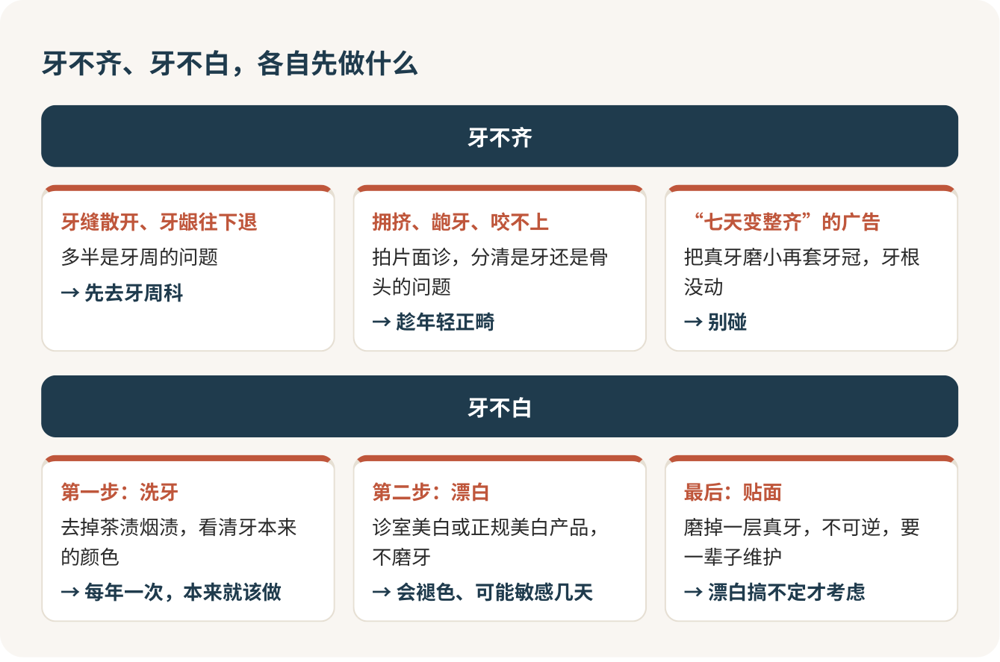

# 牙不齐不白：先正畸，贴面排最后

牙不齐，趁年轻先正畸；牙不白，先洗牙，再考虑漂白；贴面排在所有办法的最后。最不能做的一件事，是为了白去磨牙。磨掉的那层釉质一辈子都长不回来，而你才二十岁出头，后面还有几十年要用这口牙。

贴面像什么？像为了套一个好看的定制手机壳，先把手机边框打磨掉一圈。壳坏了可以换，磨掉的那一圈永远回不来。咨询室里，医生把比色板一片片贴在你门牙边上比，屏幕上放着又白又齐的模拟图，人最容易在这时候上头，最容易忘的就是那一圈。

## 先对着镜子看两下

打开前置摄像头，做两个动作。第一，嘴唇完全放松，别抿，看上下唇能不能自然合上。第二，慢慢咬合，看上下门牙怎么碰到，后牙两边是不是都咬得上。

下面这些情况，值得去挂一次正畸科：咬东西费劲、上下牙咬不上；牙挤成一团，刷牙怎么都刷不干净；牙往外龅，嘴唇合不拢；下巴歪、张嘴时关节咔咔响；老咬到腮帮子。只是觉得不够好看，也可以去问，面诊不等于开始治疗。

有一种要先绕道：牙缝是一点点“散开”的，牙龈往下退、牙缝里出现小黑三角。这多半是牙周出了问题，先去牙周科，把牙周治好了再谈正畸。有蛀牙的先[补牙](蛀牙.md)，去面诊前顺手[洗个牙](洗牙.md)。

## 面诊这笔钱，花得值

自拍只看得到牙冠，看不到牙根、骨头和上下颌怎么咬在一起。一次正规的正畸面诊会拍片、取模型、拍脸部照片、量骨骼数据，然后告诉你：你是牙的问题还是骨头的问题，要不要拔牙，只靠正畸能不能解决。设计费几百到一千，我愿意在花几万之前先买这份专业意见。

> 我主要是拥挤、龅牙，还是咬合不对？是牙齿问题还是骨头问题？只靠正畸能解决吗？

刷到“七天变整齐”“不用戴牙套也能矫正”的广告，别碰。那是把好好的牙磨小，再套上牙冠，牙根一动没动，算不上正畸，是拿你的真牙换一个看起来整齐的样子。

## 年轻，就是正畸最大的本钱

成年人能不能矫正，看的是牙周健不健康，跟年龄没有硬门槛。但成年人的骨头不再长，牙齿挪得慢，疗程更长，摘了牙套还要戴更久的保持器。越晚开始，代价越大。

钱这件事要有心理准备。正畸不进医保，全得自己出。全国来看，传统钢牙一个疗程一般一到三万，隐形牙套多在三万以上。北京的公立医院有个细节对大学生特别扎心：十九岁以后才开始的，牙再简单也按复杂那一档收费，按上限算，加上保持器四万出头，矫治器、托槽这些耗材还另算。所以面诊时我一定会要一份书面报价，逐项问清楚：

> 这个价包不包括设计费、矫治器、复诊、拔牙、保持器和拆除？保持器丢了重做多少钱？

## 钢牙还是隐形：选你做得到的那个

金属牙套便宜、技术成熟，就是不好看；陶瓷的颜色接近牙齿，贵一些；隐形牙套透明、能自己摘，最贵，疗程也偏长。

很多人一上来就要隐形，图的是好看。我的建议是先问自己一个问题：你能不能做到每天除了吃饭刷牙都戴着？隐形牙套的效果，一半握在你自己手里，摘下来忘在食堂餐盘上、晚上嫌难受不戴，几万块就打了水漂。管不住自己的，老老实实选钢牙，至少它不会被你偷偷摘下来。

> 我适合隐形吗？如果我做不到每天戴够时间，会有什么后果？

## 第一周最难熬

刚戴上和每次复诊加力后，牙会酸胀、咬东西没劲，一般两三天就缓解，一周左右基本适应。头几天喝粥、吃面条，食堂的鸡腿先放一放。钢牙的托槽会磨嘴，口腔里磨出小口子，用正畸保护蜡把突出的地方盖住；钢丝扎嘴了就回医院剪。

不好意思笑、拍照想捂嘴，也是很多人头一个月的真实心情。说句护短的话：戴牙套的人满校园都是，没人会盯着你看，大家只会觉得你在认真对待自己。

戴上以后，每隔一个多月复诊一次；硬的、黏的、带骨头的少吃，别用门牙直接啃；每顿饭后都刷牙，配上正畸牙刷和牙缝刷，刷法可以回看[刷牙那一篇](刷牙.md)。托槽边上最藏污纳垢，刷不干净就蛀牙、牙龈发炎，牙是摆齐了，却搭进去一颗好牙，那才是真亏。

## 保持器是正畸的另一半

摘了牙套不等于结束。牙齿刚挪到位，会想往回跑，像书架上挤歪的一排书，扶正以后得在两头放上书立顶住，保持器就是那对书立。第一年几乎全天戴，之后改成晚上戴，再慢慢减，成年人要戴得比青少年久。自己提前不戴，牙齿回到原位，几万块就算白花，重新矫正还要再付一笔。保持器这一步，必须做。

## 把毕业也算进去

大学生正畸还有一笔别人不用算的账：你在这座城市还待几年。疗程加保持期，很可能比你离毕业的时间还长。开始前就问清楚：

> 按您的估计，我的疗程大概多久？我还有两年左右毕业，中途离开这里的话怎么转诊、费用怎么算？

换医院往往要重新交设计费。真要走，把方案、模型或口扫数据、片子都带上；尽量在毕业前把保持器做好，想好之后去哪复查。

## 想白：洗牙、漂白，最后才是贴面

牙黄先去洗牙，茶渍、烟渍洗掉以后，看看牙本来是什么颜色。只是表面发黄，下一步是漂白：诊室美白和家用美白牙贴都不磨牙，代价是效果会慢慢褪、可能敏感几天。网上买的美白产品自己用，要选正规的，按说明来，牙酸牙龈疼就停；有牙周病的先治牙周再美白。

贴面适合的是那些漂白解决不了的情况：四环素牙、氟斑牙这种深层变色，门牙缺了一角、天生过小、缝隙太大。只是想再白一个色号，我的判断很干脆：别做。

它的代价是实打实的。要磨掉一层真牙，不可逆，将来拆了也回不到原样；要跑好几趟，磨完到粘上之前牙可能一直发酸；会崩、会掉、会染色，要一辈子维护，边缘照样会蛀。夜里磨牙、紧咬牙的人多半不适合。钱也不少，一颗瓷贴面三四千，门牙一排六颗做下来两万出头，不进医保。

真到了非做不可的那一步，只找正规医院或口腔诊所里的口腔医生，美容院、工作室、上门服务一律不考虑。签字前要一张写着颗数、单价、坏了怎么修的纸：

> 这几颗要磨掉多少？以后不想要了还能恢复吗？崩了或者掉了，重粘、重做怎么收？

挂号之前，先在日历上数一数，你离拿毕业证还有几个学期。

## 参考

- [四川大学华西口腔医院：笑起来不够美？可能你还需要正牙](https://www.hxkq.org/Html/News/Articles/9001.html)
- [中南大学湘雅口腔医院：哪些人需要正畸治疗？](https://xykqyy.csu.edu.cn/info/1012/6804.htm)
- [中华医学会：戴牙套后如何做好日常维护？](https://www.cma.org.cn/art/2023/6/26/art_4584_51440.html)
- [北京大学口腔医院正畸科：保持器应戴用多长时间？](https://ss.bjmu.edu.cn/Html/News/Articles/1215.html)
- [国家医疗保障局：呵护一口好牙从青少年开始](https://www.nhsa.gov.cn/art/2025/2/28/art_52_15823.html)
- [清华长庚医院：牙齿美白大揭秘 科学美白不踩坑](https://www.btch.edu.cn/ksdh/kqk/jkjy_kqk/87349fdc8c8742dab6812d07ce8b83d1.htm)
- [American Dental Association MouthHealthy: Veneers](https://www.mouthhealthy.org/all-topics-a-z/veneers)
- [吉林大学口腔医院：全瓷贴面来报到 美丽笑容重来到](https://jdkq.jlu.edu.cn/info/1020/2785.htm)

<!-- NAV:BEGIN -->
---

上一课：[蛀牙：越拖越贵，别等它疼](蛀牙.md) · [回目录](../../README.md) · 下一课：[配眼镜：钱花在验光上，别花在镜框上](配眼镜.md)
<!-- NAV:END -->
