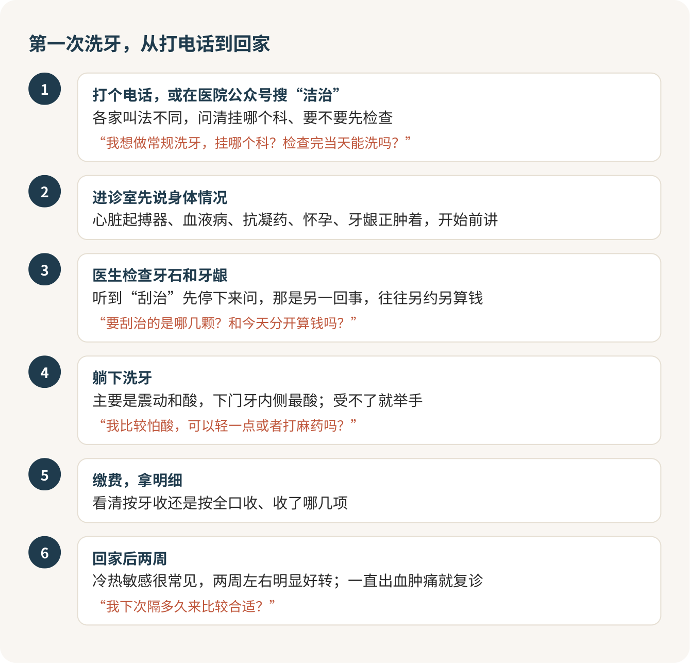

# 洗牙：别怕，每年去一次

洗牙每年一次，第一次现在就去，别等牙龈出血、口气重了才想起它。它没有你想象的那么疼，也不会把牙洗坏。北京的公立医院洗一次全口，加上挂号，封顶也就五百上下，外地不少医院两三百就能搞定。把自己收拾体面这件事里，这是我最推荐花的一笔钱。

牙石像宿舍电热水壶底那层白色水垢。你每天冲、偶尔晃一晃，它照样一层一层长，哪天想去掉，只能专门除一次垢。牙刷对付不了牙石，洗牙就是那次专门的除垢。刷牙刷得再认真，这一步也省不掉。

## 你怕的那几件事，多半是自己吓自己

怕疼？牙龈健康的人洗牙，感觉主要是嗡嗡的震动和一阵阵酸，谈不上疼。最酸的往往是下门牙内侧，那里牙石最厚。真要酸到受不了，举手就行，医生会调小一点或者停一会儿。特别怕酸的人可以提前要麻药，这一点也不丢人。

怕出血？洗牙出了不少血，很多人第一反应是“把牙龈洗伤了”。正好相反，健康的牙龈几乎不出血，出血多说明牙龈本来就在发炎，洗牙只是让它露了馅。洗完好好刷牙，下次再来就会少很多。

怕牙缝变大？有人洗完觉得牙缝大了、牙有点松，说话漏风。这是牙石原来把发炎撑大的牙缝填满了，像夹板一样箍着，一洗掉问题才露出来。该怪的是那层牙石，洗牙不背这个锅。真遇到这种情况，接着查牙周，别后悔洗了牙。

怕被说牙脏？医生一天看几十张嘴，你那点牙石在他眼里根本排不上号。你是来解决问题的，用不着为牙石不好意思。

## 门口那一下最难

第一次去，最难的往往是挂号前那一下犹豫：挂哪个科？要不要先检查？说错了会不会很尴尬？其实一个电话就能问完。不同医院叫法不一样，有的放在牙周科，有的在综合科或预防科，在医院公众号里搜“洁治”最快。

> 我想做常规洗牙，挂哪个科？需要先挂号检查吗？检查完当天能洗吗？

进了诊室，先把身体情况说在前面：装了心脏起搏器、有血液方面的病、在吃抗凝药、怀孕、牙龈正肿着，这些都要在开始前讲。这不是多嘴，是给医生的安全提示。

躺上椅子，灯照着脸，嘴张得酸，耳边全是滋滋声，前五分钟最难熬，后面就习惯了。别憋气，用鼻子慢慢呼吸，口水多了医生会帮你吸。整个过程你只需要张着嘴，剩下的全是医生的事。

## 要盯紧的只有两件事

**一是洁治还是刮治。** 平常说的洗牙，医生叫“洁治”，清的是牙龈上面的牙石。如果检查发现牙龈下面已经有了牙周袋，医生会建议“刮治”，那是另一回事，往往要分几次做，钱也另算，而且比洗牙贵。听到“刮治”两个字，先停下来问清楚，这一点也不失礼。

> 要刮治的是哪几颗牙？分几次做？和今天的洗牙分开算钱吗？

**二是按牙收还是按全口收。** 北京的公立医院按颗算，洗牙、抛光各算一笔，牙齿色素多才会加喷砂；有的医院按全口打包，民营诊所多半是套餐。洗完拿一份缴费明细，看看收了哪几项，花得明明白白。

> 这次是按牙收还是按全口收？洗牙、抛光、喷砂分别多少？包不包括检查和拍片？

网上那种一两百、还送拍片的洗牙套餐，我的态度是：能用，但先把小字看完。这种价格多半是为了先把你拉进门，进去以后再推刮治、推美白；有的挂在信用卡权益里，到期自动续费扣钱。买之前问清包含什么、会不会自动续费，到了诊室只洗你想洗的。

医保这件事，学生的情况五花八门：北京医保、老家医保、学校自己的医疗保障，能报多少差得很远。在北京读书的外地同学，先去校医院或学校医保办问一句自己属于哪种，再决定去哪家医院，比什么都省事。民营诊所多半走不了医保。

## 洗完两周，这些都正常

当天别吃太冰太烫的，晚上照常刷牙、过牙线。接下来几天牙齿对冷热敏感很常见，两周左右会明显好转，期间少碰冰饮和酸的，敏感得厉害可以换抗敏感牙膏。牙龈一直出血、肿痛不消，就回去复诊。

洗完牙没变白，也别失望。洗牙只能去掉茶渍、烟渍，把牙本来的颜色还给你，天生偏黄的牙洗不白。想要更白，先看[正畸与贴面那一篇](正畸与贴面.md)，千万别冲动去磨牙。洗牙时医生顺手指出了蛀牙，别拖，看[蛀牙那一篇](蛀牙.md)。

> 我下次隔多久来比较合适？

多久洗一次，健康的人一年一次差不多；容易长牙石、抽烟、天天喝茶喝咖啡的，可能半年就得来。第一次去的意义，就是让医生告诉你自己属于哪一种。

走出诊室前，问医生一句“我下次隔多久来”，然后当场把日子记进手机日历。

## 参考

- [四川大学华西口腔医院：洗牙会让牙齿松动牙缝变大？不要再继续误解洗牙了](https://hxkq.org/Html/News/Articles/14059.html)
- [北京市卫健委：牙周洁治——守护口腔牙周健康](https://wjw.beijing.gov.cn/jyt2023/jytjksh/202606/t20260604_4685671.html)
- [北京市卫健委：常见口腔治疗误区之洗牙篇](https://wjw.beijing.gov.cn/bmfw_20143/jkzs/jksh/202312/t20231227_3513155.html)
- [北医人爱科普：口腔健康是一种文明的标志](https://bynews.bjmu.edu.cn/tszt/byrakp/778e71d0d1a4442da7f2435588a0f4ec.htm)
- [清华长庚医院：牙齿美白大揭秘 科学美白不踩坑](https://www.btch.edu.cn/ksdh/kqk/jkjy_kqk/87349fdc8c8742dab6812d07ce8b83d1.htm)
- [北京市医疗保障局：关于调整规范综合诊查等11类医疗服务价格项目的通知](https://www.beijing.gov.cn/zhengce/zhengcefagui/202604/t20260415_4582642.html)

<!-- NAV:BEGIN -->
---

上一课：[刷牙：毛病多半出在牙缝](刷牙.md) · [回目录](../../README.md) · 下一课：[蛀牙：越拖越贵，别等它疼](蛀牙.md)
<!-- NAV:END -->
