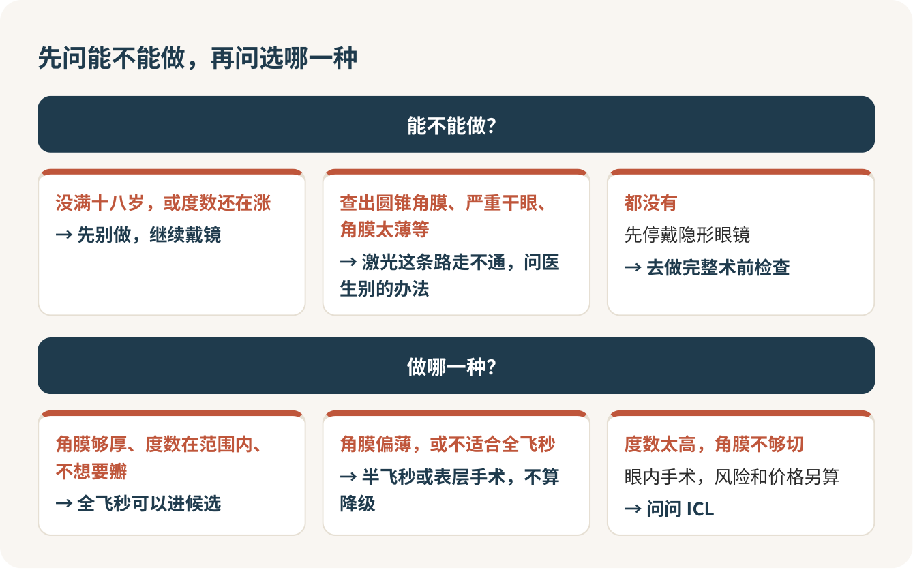

# 近视手术：想清楚就去做，全飞秒不是唯一答案

度数稳定了两年、受够了戴眼镜，近视手术值得做，想清楚了就去，别被网上那些吓人的帖子拖上好几年。但进医院之前，先把“我要做全飞秒”这句话咽回去。做哪一种，该由你的检查报告来挑，轮不到朋友圈和销售的嘴。

## 怕的东西，先说出来

想做手术的人，心里多半揣着两种怕。一种是怕疼、怕瞎：激光打在眼睛上，万一我眨眼了呢？另一种是怕被宰：一进民营医院大厅，就有人热情地领你去做检查，报价从一万多跳到两万多，“专家价”“新设备价”，你根本不知道哪个是真的。

两种怕都正常，也都有办法。疼的事后面说，结论是比你想的好受；怕被宰的办法只有一个：你自己先弄明白顺序，先问能不能做，再问做哪种，最后才谈钱。

## 能不能做：先看三件事

第一，年满十八岁，而且度数稳定。稳定的意思是近两年每年涨得不多，具体让医生看你的历年验光记录。还在长度数的，现在做了，过几年又近视回去，这钱白花。大一刚入学、每年还涨五十度一百度的，我劝你再等等。

第二，角膜够不够厚。这是报告上最容易被你略过的一行，却最要紧。激光手术说白了是在角膜上“雕”掉一层，我常拿橡皮打比方：要刻掉多少由你的度数决定，橡皮本身多厚是天生的。橡皮太薄，医生就不敢按你想要的方式刻，甚至不能刻。

第三，眼睛有没有不能做的毛病，比如圆锥角膜、严重干眼、眼睛有炎症。这些都靠术前检查查出来，你不用自己判断。

还有一条最容易打乱计划：检查之前要停戴隐形眼镜。普通软镜停一两周，散光软镜和硬镜停三四周，OK 镜停三个月以上。这段时间老老实实戴框架，提前算好日子，别撞上考试周。

> 我戴的是日抛隐形眼镜，检查前要停多久？散瞳以后多久能看清，我能自己回宿舍吗？

术前检查项目一大串，还要散瞳，那天留出整整半天，别排课。

## 做哪一种：报告说了算

市面上常听到的有四种，我用最直白的话讲一遍。

全飞秒：激光在角膜里面切出一片薄薄的透镜，从一个两三毫米的小口子取出来，不用掀角膜瓣。恢复快，适合运动多、不想要瓣的人，但对角膜厚度和度数范围要求更严。

半飞秒：先用激光做一个角膜瓣，掀开，再用另一种激光切削，最后盖回去。这是做得最多、最成熟的一种，便宜一些，视力恢复也快。

表层手术：把角膜最表面那层上皮去掉，在表面切削，再戴一副绷带镜等上皮长回来。角膜偏薄的人常被推荐这种，便宜得多，代价是术后头几天最疼、恢复最慢。

ICL：在眼睛里面放一片定制的晶体，不切角膜，属于“做加法”。度数特别高、角膜条件不够的人可以考虑，能取出来，但它是眼内手术，风险另算，价格也最高。

我要给“全飞秒最先进、最好”这句话贴个标签：营销话术。全飞秒是好，可它最贵、要求最严，不是每个人都适合。医生看完你的角膜，建议你做半飞秒或者表层手术，这不叫降级，这叫对你的眼睛负责。

影视飓风的分频道“亿点点不一样”拍过一期近视手术的视频，正好把这件事拍得很清楚：团队里一位同事做了全飞秒，主持人也做了检查，因为角膜偏薄，医生建议他改做半飞秒。同一家医院、同一天，两个人得到的答案不一样。这是别人的一段经历，当医学依据用不了，但用来消除“我是不是被忽悠降级了”的疑心，挺管用。想提前看看检查和手术到底长什么样，也可以去看看。

> 按我的角膜厚度和度数，适合哪几种手术？为什么推荐这一种，不推荐另一种？

## 钱：先问单眼还是双眼

这是最容易被绕晕的地方。同一个数字，单眼和双眼差一倍，很多报价写着“九千多”，那是一只眼。

大概的行情：全飞秒双眼差不多两万，公立医院也是这个价位；半飞秒便宜一些；表层手术双眼不到一万。民营医院同一家店里，换个“专家”价格就能差好几千。我的倾向是，同等条件下先去公立医院眼科挂号，价格透明，你不用跟销售斗智斗勇。

检查也要花钱，而且查完被判定不能做，这钱一般不退。所以检查前就问清楚：

> 检查费多少？要是查完不适合做，检查费能退或者抵扣吗？报告能带走去别家看吗？

决定做之前，让医院给你一张分项清单：单眼还是双眼，含不含术前检查、术后药水、复查，复查包几次。只有口头报价的，先别交钱。

## 疼不疼：比你想的好受

麻醉就是滴几滴麻药眼药水，不用全麻。眼睛还能动，所以医生会让你盯着一个绿灯别动。那几分钟眼前白茫茫一片，有压迫感，能听到机器的声音，真正打激光就几十秒。不少人事后的感受是：比排队等着进去的时候轻松多了。

你最怕的“万一眨眼”，机器会盯着你的眼睛，眼睛一动它会停下，医生判断好了再继续。所以别紧张，跟着医生的指令走就行。

术后的感受因术式差很多。全飞秒和半飞秒，当晚眼睛会刺痒、发烫、流泪，睡一觉大多就好多了，第二天基本能看清。表层手术头两三天是真的疼，要备好止痛药，三五天才慢慢看清，完全稳定要一个月左右，做这种的人记得请几天假。

手术当天一定找个同学陪你，结束后有人带你回去。

## 真实的代价，别装看不见

我支持想清楚的人去做，但有几件事你得提前接受。

干眼几乎人人都有一阵，头一个月最明显，人工泪液得常备，少数人会更久。晚上看灯可能有光晕、眩光，开夜车和夜里骑车的人要有心理准备。度数有回退的可能。最重要的一条：手术改的是角膜的形状，你眼睛里本来的东西没变，高度近视的人眼底该有的风险一样都没少，以后该查眼底照样要查；到了四五十岁，老花眼也照样会来。

复查要排进日程里：术后第二天、一周、一个月、三个月……前前后后要跑大半年。暑假做的话，算好开学前要完成的那几次，离开城市以后去哪儿复查也提前问。

底线一条：术后突然眼睛很痛、很红、视力明显下降，别等下次复查，当天回医院。

## 参考

- [中华医学会眼科学分会：激光角膜屈光手术临床诊疗专家共识（2015 年）](https://master.yiigle.com/uploads/guide_html/%E6%BF%80%E5%85%89%E8%A7%92%E8%86%9C%E5%B1%88%E5%85%89%E6%89%8B%E6%9C%AF%E4%B8%B4%E5%BA%8A%E8%AF%8A%E7%96%97%E4%B8%93%E5%AE%B6%E5%85%B1%E8%AF%86%EF%BC%882015%E5%B9%B4%EF%BC%89.html)
- [美国眼科学会：什么是全飞秒（SMILE）](https://www.aao.org/eye-health/treatments/what-is-small-incision-lenticule-extraction)
- [美国眼科学会：LASIK 激光手术](https://www.aao.org/eye-health/treatments/LASIK)
- [美国眼科学会：表层手术 PRK](https://www.aao.org/eye-health/treatments/photorefractive-keratectomy-prk)
- [美国眼科学会：ICL 晶体植入](https://www.aao.org/eye-health/treatments/implantable-collamer-lens-icl)
- [亿点点不一样：近视手术视频](https://www.youtube.com/watch?v=F_IxSXxofSY)

<!-- NAV:BEGIN -->
---

上一课：[隐形眼镜：日抛最省心，OK镜多半不是给你的](隐形眼镜.md) · [回目录](../../README.md) · 下一课：[护肤：洗脸、保湿、防晒，三样就够](护肤.md)
<!-- NAV:END -->
