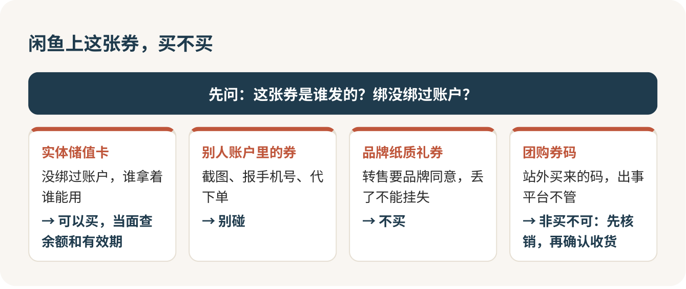

# 同一顿饭少花钱：团购先比价，二手券要小心

团购下单前，美团和抖音两边都打开看一眼，这三十秒必须花。闲鱼上的二手餐饮券，除了没绑过账户的实体储值卡，别的我都劝你别碰。至于探探糖这类新冒出来的低价渠道，可以玩，但只拿一顿饭的钱试水，规则没看明白之前，一分钱都别往里充。

这三件事其实是一件事：你省下的每一块钱，都得是真能吃到嘴里的那一块。

## 同一家店，两个价

有记者做过一个很简单的实验：在望京一家石锅拌饭店里，把美团和抖音并排打开。同一份双人餐，菜一模一样，名字一个叫“TG10 超值双人餐”，一个叫“DY16 超值双人餐”，一边六十出头，一边快八十。店员的解释也很实在：那边有补贴。

这件事别拿去推断“哪个平台更便宜”。补贴今天在这边，下周可能就跑到那边去了，没有哪个平台永远便宜。它真正该让你记住的是：套餐名字是摆设。就像食堂两个窗口都卖宫保鸡丁，一个叫“招牌鸡丁”，一个叫“川味小炒”，你得看勺子里几块肉、几颗花生，再看价签。

所以比价的时候，我只认三样东西：同一家分店，同一份菜，最后从你手机里出去的钱。

## 两个 App 并排，一行一行对

在两个 App 里搜到同一家分店（只搜品牌不算，望京店和五道口店是两回事），点进套餐详情，把“套餐内容”逐行对：肉是大份还是小份，饮料几杯，米饭锅底茶位餐具算不算在里面。名字不同菜可能一样，名字一样菜也可能不一样。

然后算到手价，别看几折。锅底、茶位另收的，加上；为了凑满减多点的那盘菜，加上；页面上那个最显眼的低价，往往是勾了某张神券之后的价，这张券本来能留给下一顿，也该算进去。还有一条很多人不知道：用了券的团购单，退款时券是不退回来的。

算完如果两边只差一两块，我的选择很明确：选写着“随时退”“过期自动退”的那一边，选预约规则更省事的那一边。为了一两块钱多耗十分钟，再搭上一张退不了的券，不值。

## 团购页上的“原价”，别当真

这是最容易被骗到的地方。团购页上划掉的那个“原价”，是把套餐里每道菜的标价加起来，而这个标价，可能比店里纸质菜单上的还高。有报道写过一家涮肉店：团购页上一份羊肉标六十多，店里菜单上同款大份五十出头；一份白菜团购页标八块，菜单上三块。

所以“三折”“四折”这种字眼，对我来说就是噪音。我只比两个数：团购实付多少；不用团购，按店里菜单点同样的菜要多少。后一个数，很多时候到了店里拿起菜单才知道。如果你发现菜单价比团购页标的“原价”低，拍下来在平台里反映，平台规则本来就不允许这样标。

有几种情况，我干脆不用团购。四人套餐三个人吃，多出来的菜吃不完，单点更省；套餐里一半是你们不想吃的菜，“原价”标得再高也跟你没关系；券只限午市，你们只能晚上去，这张券对你就等于不存在。

## 进门亮券那一下，别不好意思

第一次用团购的人，多半会在门口犹豫：拿着一张打折券，会不会被服务员看轻，会不会被安排到靠厕所的位置。我想告诉你，完全不用想这些。你是付了钱的客人，团购是店家自己上架的，用券是在帮他完成订单。

真正该担心的是另一件事：到了店里，券用不了。周末不可用、只限午市、要提前一天预约、每桌限用一张，这些小字最容易出事。周末去之前，我会先打个电话：

> 你好，我在抖音买了你们的双人套餐，这周六晚上六点两个人过去，能直接用吗？要提前约吗？

预约时有一条要守住：别把券码发给商家。有的店预约阶段就让你报码，顺手就核销了，人还没到券先没了。预约成功截个图就够。

进门坐下，先说券，再点菜：

> 我们有张团购券，麻烦先帮我核一下，套餐里的菜今天都有吧？

套餐里有道菜没了，先问能不能换同价位的，别直接掏钱补差。结账前再问一句锅底、茶位算不算在里面，心里就有底了。

和室友一起吃，一个人先垫了团购钱，下单前就说好怎么分。团购实付加上店里另付的，按人头一除，谁不喝饮料谁少出一份，买单前讲清楚，比吃完对着小票算账体面得多。

## 闲鱼二手券：先问是谁发的，再看价格

闲鱼上标着“咖啡券”“汉堡券”的东西，便宜得让人心动。但这一块我的态度很保守，因为同样叫“券”，背后完全是几种东西。

第一种，不记名、没绑过账户的实体储值卡，比如星巴克的实体星礼卡。谁拿着谁能用，转手在规则上说得通。这一种可以买，但要当面交易，请卖家当着你的面查余额、看有效期。

第二种，别人 App 账户里的券。卖家说“我把截图发你”“到店报我手机号就行”，就是这一类。麦当劳的会员协议写得明明白白：卡券不能转让、转售、截图，也不能代下单。这种券今天能用，明天可能就被风控取消。这是智商税，别碰。

第三种，品牌发的实体礼券。比如麦当劳的纸质礼券，章程要求转售得先拿到品牌的书面同意，丢了也不能挂失。出了问题你找不到人说理，我也不买。

第四种，团购平台的券码。码本身也许用得了，可美团条款写着团购券不能在站外转售，从别处买来的码出了事，平台不管。你只能找卖家和闲鱼。如果非要买，规矩是：在卖家已经发码、你还没确认收货的那段时间里去店里核销，核销成功再点确认。

交易时把话都问在闲鱼聊天里：

> 这张券是哪家发的？实体卡还是截图？绑过账户吗？到店核销不了，你能退款吗？

听到“加个微信，再便宜点”，直接关掉对话。离开平台交易，出了事聊天记录里什么都没有，等于把钱塞进别人口袋里还说了声谢谢。

另外留个心眼：闲鱼订单过几天会自动确认收货。券面有效期还长，订单却快自动确认了，一定在那之前把券用掉。到店核销失败，当场拍下提示页面，先别确认收货，联系卖家退款，不行就申请闲鱼介入。

最后算一笔账再决定。二手券便宜十块，可万一用不了，你打车来回的钱、在店里改按原价点单多花的钱，加起来很容易超过十块。只有省下的钱明显大过这些，才值得试。

## 探探糖这类新渠道：小额试，别充值

探探糖是一个微信小程序，卖到店餐饮的套餐券，玩法是价格随时间往下降，名额有限，抢到就便宜，宿舍群里常有人转。

我对它的态度是：可以试一次，但要拿“就算打水漂也不心疼”的钱去试。原因很简单，这类平台的规则往往藏得深。有媒体报道过南京的两件事：一个人买了张火锅券，过期了，平台不给延期也不给退；另一个人买的双人套餐券，到店才知道这家店已经和平台终止合作了，券却还挂在上面卖，反映了好几次才退回钱。网上还有人吐槽，强行退款要被扣掉一大笔手续费。

所以下单前，我会在小程序里做三件事。

第一，点右上角的“…”进资料页，看清楚到底是哪家公司在运营，记下客服入口。找不到的，不买。

第二，看商品详情页：有效期几天、从哪天开始算，要不要预约，周末能不能用，退款怎么写，写没写要扣多少钱。有效期只有几天、你又不确定那几天能去的，别买。

第三，给门店打个电话：

> 你好，你们店现在还收探探糖的券吗？这周末能用吗？

还有一条底线我要说死：不管哪个新渠道，让你先充值、办储值卡、买“会员包”才能享受低价的，规则没有一条一条看明白之前，别充。充进去的钱，平台跑了、店不合作了、你不想用了，都很难拿回来。按微信的规定，小程序退款应该原路退回，不能强行给你退成余额、积分或代金券；真遇到这种事，截图留证据，在小程序里申请，不处理就打 12315。

抢到了也别急着高兴，下单前顺手看一眼同一家店在美团、抖音上的同款套餐。只贵几块钱、写着“随时退”的那边，往往才是更划算的那一个。

## 记住这几条就够了

团购两边都看，比到手价，不比折扣；差一两块，选能退的。闲鱼只买当面验过的实体储值卡，截图券、报手机号的券一律不碰。新渠道小额试，先打电话问店，别充值。

下次在宿舍刷到“一块钱吃火锅”，先别急着点，问自己一句：这钱，我真的吃得到吗？

## 参考

- [美团团购服务保障](https://rules-center.meituan.com/m/detail/guize/386003)
- [美团团购用户服务条款](https://rules-center.meituan.com/m/detail/guize/1)
- [抖音生活服务商品退款服务规范](https://lifexue.com/rule/detail/123777)
- [团购价高于菜单价，优惠or套路？（丹阳日报）](https://www.dy001.cn/2026/0623/231437.shtml)
- [麦当劳消费提示：认准官方渠道](https://www.mcdonalds.com.cn/news/transaction-reminder)
- [星巴克星礼卡常见问题](https://www.starbucks.com.cn/help/gift)
- [买了优惠券店家却不接待，过期还不能退！探探糖平台遭消费者吐槽（南京零距离）](https://news.qq.com/rain/a/20250521A09KEV00)
- [微信小程序平台运营规范](https://developers.weixin.qq.com/miniprogram/product/)

<!-- NAV:BEGIN -->
---

上一课：[咖啡馆和茶馆：说出口味，比背名词有用](咖啡馆与茶馆.md) · [回目录](../../README.md) · 下一课：[酒吧：不懂酒，就按口味点](../3-出门玩/酒吧.md)
<!-- NAV:END -->
