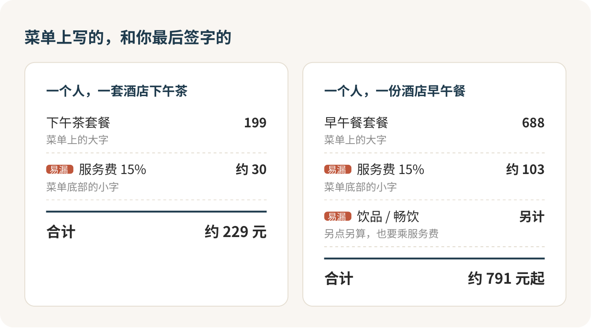

# 西餐厅和酒店下午茶：怕的不是刀叉，是账单

不住这家酒店，照样可以大大方方走进它的西餐厅、它的茶室。第一次去，真正该提防的不是刀叉，是菜单最底下那行比菜名小一号的字：“另加 15% 服务费”。刀叉拿错了，服务员给你换一副，没人记得；那行字没看见，签字的是你。

## 推门那一下最难

几乎每个第一次去的人都卡在同一个地方：酒店大堂。门童、前台、电梯、一地反光的大理石，好像得先跟谁解释一句“我不住店，我就来喝个茶”。

不用解释。酒店的餐厅和茶室本来就对外营业，你和住客唯一的区别，是钱从手机里出，不挂在房账上。把它想成去隔壁学校蹭一家出了名的食堂：保安不拦你，你只要知道食堂在哪栋楼、几号窗口，直接走过去。

所以出门前只做一件事：记下那间餐厅或茶室叫什么、在几楼。进门别去前台，前台管住宿登记，你过去多半也是被指向电梯。直接找门口的迎宾或者礼宾：

> 你好，我订了三点的下午茶，两位，姓王。

没订也能问：“请问现在还有位子吗？”周末下午和晚餐我一定提前一两天订，工作日临时去碰碰运气也行，没人会因为你是散客给你脸色。

穿什么，别想太多。这类餐厅大多只写“smart casual”，意思是比去食堂整齐一点：干净的上衣，能见人的鞋，不穿拖鞋。我觉得比衣服更要紧的是鞋舒不舒服，一顿正式西餐要坐两个小时。

## 先把菜单价乘一遍，再决定点不点

这是全篇我最想让你记住的一件事：看到百分号，先乘进去。

几个数让你有个体感。北京四季酒店茶园的一套京味下午茶，菜单写 199 元一位，加 15% 服务费，结账是两百三左右。王府井文华东方文华扒房的早午餐，菜单上醒目地印着 688 元一位，乘完服务费就是快八百，饮品还没算。菜单价和结账价差出来的那一截，就像外卖页面上的配送费，只不过它被印在了你最不会看的地方。

有的菜单写“10% 服务费和 6% 税”，有的写“已含服务费和税”，有的写“附加费”。名字五花八门，意思都一样：在菜单价上再按比例加钱。拿不准就在订座时问一句：

> 这个价格含服务费吗？两个人大概一共多少？

把预算在电话里报出来，一点都不丢人。服务员听到“两个人想控制在一千六以内”，反而知道该怎么帮你。

## 第一次吃正式西餐，选工作日午餐

如果非要我给一个入口，我选工作日的商务午餐。同一间餐厅、同样的刀叉和服务，三道菜的午市套餐比晚餐便宜一大截，像北京四季的意大利餐厅，商务午餐加完服务费三百出头。晚餐和早午餐留给第二次，那时候你已经不紧张了，才吃得出好坏。

早午餐的畅饮，第一次我劝你别碰。两小时无限续杯听着划算，加一份就是一两百，再乘服务费，一桌人的预算常常就是被这一项顶穿的。想喝一杯，就单点一杯，把上限告诉服务员：“我想要一杯红葡萄酒，一百五以内，您推荐哪一款？”

还有一个小坑：服务员问 “still or sparkling”，是在问你要普通水还是气泡水。别默认它免费，也别默认它收费，问一句“这个收费吗”就完了。

## 刀叉真的不难

从最外侧那一副开始用，吃完一道，服务员连盘带餐具一起收走，下一道再用往里那一副。叉在左，刀在右，就这么多。有的餐厅每道菜现上餐具，那更省心。拿不准就问，比偷看邻桌快，也比你想象的体面：

> 我第一次来，这三道主菜有什么区别？哪道一个人吃份量合适？

看不懂的菜请服务员讲，这本来就是你付服务费买的东西。牛排熟度说不出英文词，就说你想要的口感：“中间还有点粉，别太生。”菜单上写着“建议两位分享”的，别一人点一份。

忌口要说两次，订座一次，点菜一次。过敏要直接说“过敏”，别说“不太爱吃”，厨房听到这两个词的反应完全不一样。端上来的菜里有你说过不能吃的东西，别将就，叫人换。

## 下午茶：拍完就吃，热的凉了可惜

三层点心架端上来那一刻，大多数人都会掏手机，这很正常。别站到别人桌边取景，别开闪光，拍完就吃，热点心凉了差一大截。服务员讲解每一层是什么，你点头就行，不用记。

茶园和大堂吧有轻音乐和说话声，正常聊天没问题，邻桌听不清你们在说什么就行。茶喝完直接说“麻烦加点热水”。一套下午茶坐一个半到两个小时刚好，快打烊前的时段别订，吃不完会被提醒。

预算紧，也有路。不少老牌酒店有一两百元的双人下午茶套餐。第一次只是想体验一下“在酒店喝下午茶是什么感觉”，这种就够了，没必要拿第一次去赌服务费最高的那家。

## 能吃饭，不等于能下泳池

这是不住店的人最容易误会的一点。餐厅、茶室、酒吧对外开放，健身房和泳池多半只给住客。“喝完下午茶顺便游个泳”这个念头，趁早放下。真想体验，正路是订一晚房，或者问问有没有对外的日间套餐。

## 买单：明细必看，小费不用给

服务员推荐加菜、加酒，不合适就直说“谢谢，今天够了，就按刚才点的来”，语气平常，不用解释。吃不完可以打包，理直气壮。结账前要一份明细，只看三处：服务费按几个点算、基数对不对；写着“已含服务费”的菜有没有被又加一遍；饮品是不是你点过的那几样。菜单上没写的项目冒出来，指着它问“这一项是什么”，商家本来就不能收没标明的钱。

小费在国内的餐厅不是默认动作，服务费已经在账单里了。你该盯的是服务费有没有算对。

进门那一下你会紧张，这很正常。你是来花钱吃饭的，没有任何人有资格让你觉得自己不配坐在那里。签字之前，把服务费那一行再乘一遍。

## 参考

- [文华扒房｜北京王府井文华东方酒店](https://www.mandarinoriental.com/en/beijing/wangfujing/dine/mandarin-grill)
- [北京王府井文华东方酒店餐饮与常见问题](https://www.mandarinoriental.com/en/beijing/wangfujing/dine)
- [北京四季酒店 茶园](https://www.fourseasons.com/zh/beijing/dining/lounges/tea_garden/)
- [北京四季酒店 Mio 商务午餐菜单](https://www.fourseasons.com/beijing/dining/menus/mio/business-lunch-menu/)
- [Emily Post：正式餐桌怎么摆](https://emilypost.com/advice/table-setting-guides)
- [商务部《餐饮业促进和经营管理办法》](https://www.mofcom.gov.cn/zfxxgk/zc/gz/art/2025/art_8f2a2ccb933b46bba6ba30d7efbf8e8a.html)
- [明码标价和禁止价格欺诈规定](https://www.samr.gov.cn/zw/zfxxgk/fdzdgknr/fgs/art/2023/art_9a1f82a007964950a1a0f6c056f2fedf.html)

<!-- NAV:BEGIN -->
---

上一课：[健身：为了好看去练，别为了脱单](../1-把自己收拾体面/健身.md) · [回目录](../../README.md) · 下一课：[高档中餐：会点菜，比会喝酒重要](高档中餐.md)
<!-- NAV:END -->
