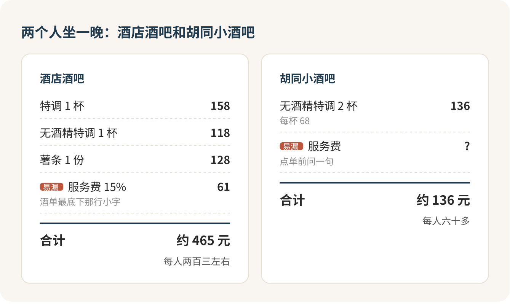

# 酒吧：不懂酒，就按口味点

第一次去酒吧，你不用懂酒，甚至不用喝酒。只要会说自己喜欢什么味道，再看清酒单最底下那行小字，这一晚就不会出错。第一次我建议去安静的清吧，坐吧台；夜店留到以后，别拿它当第一次。

很多人卡在门口那一下：推门进去，灯很暗，吧台后面站着一个穿马甲的调酒师，墙上一排看不懂的瓶子，你突然觉得自己像个闯进别人家的人。这种感觉十个第一次去的人里有八个会有。我想先跟你说清楚：酒吧就是一家卖饮料的店，你是来花钱的客人，调酒师每天都在接待不懂酒的人，你不是第一个，也不会是最后一个。

## 先挑对地方

“酒吧”底下其实是好几种完全不同的店。

清吧，也就是鸡尾酒吧，主角是吧台和调酒师，音乐不吵，能正常聊天。第一次去，首选这种。

酒店酒吧环境最稳，酒单印得最正式，价格也最高，结账多半还要再乘一个服务费。想穿得体面一点、跟朋友安安静静坐一晚，可以去；但要知道，你多付的钱主要买的是环境和景观。

小酒馆、精酿吧、餐吧吃喝一起，压力最小，跟吃顿饭差不多。

夜店音乐大、站着多、可能有入场费和卡座低消，这篇不讲，第一次也别去。

还有一点：同一家酒吧，早晚是两张脸。有的酒店酒吧前半夜是安静的鸡尾酒吧，到了深夜放上 DJ 就成了派对。想聊天，就早点去，八九点之前最舒服。

## 坐吧台，别坐卡座

如果是我第一次去，一定坐吧台。调酒师就在面前，你可以直接问、直接看他怎么做酒，一个人去坐吧台也一点不突兀。卡座适合三四个朋友聊天，代价是点单得等服务员过来，想问点什么也不方便。

周末晚上人多，或者几个人一起去，提前打个电话：

> 你好，想订周五晚上八点，两位，坐吧台就行。

穿着不用紧张。干净的衬衫、针织衫，一双干净的鞋就够了，就算是五星级酒店的酒吧，也只是“建议”穿得整洁休闲，没人拦你。拖鞋和运动背心留在宿舍。

## 点单：像在奶茶店说“三分糖去冰”

最让人发怵的，是调酒师问你“想要什么基酒”，你答不上来。其实这跟在奶茶店说“三分糖、去冰、加椰果”没什么区别：店员不需要你懂茶叶产地，只需要知道你要什么口感。调酒师也一样，他要的是一个方向，最好用的就四个字：甜、酸、苦、烈。

完全不懂、想要好入口的，就这么说：

> 我不太懂酒，喜欢酸甜一点、果味的，酒精感别太重。

有不喜欢的味道，就顺口加一句“别太苦、别要烟熏味”，把它排除掉。说完，剩下的交给调酒师。这是他最擅长、也最愿意做的事。喝到一半觉得太甜，下一杯跟他说“想要清爽一点的”，这种反馈他们最爱听，不会觉得你挑剔。

酒单上的英文认几个就够了。Highball 是烈酒兑苏打水或汤力水，清爽好入口，第一次点它很稳；Sour 是酸酒，酸酸甜甜，常打一层泡沫；Spritz 是起泡酒兑开胃酒，微苦带果香，度数不高。Martini 和 Negroni 几乎全是酒，又干又苦，第一次别碰，点了大概率喝两口就放下。

## 不喝酒也可以进，说清楚就行

今天不想喝，直接说：

> 我今天不喝酒，有无酒精的特调吗？

现在稍微像样一点的酒吧，酒单上都单独列着一栏无酒精特调，写作 mocktail、zero proof 或 non-alcoholic。连酒店酒吧都把不喝酒的人算进去了，你没什么好心虚的。

这里有个坑必须提醒：“低酒精”和“无酒精”是两回事。有的酒单上，“低酒精鸡尾酒”一栏配料里写着伏特加。如果你在吃药、要开车，或者身体一点酒都碰不得，点单时就说“一点酒都不能有”，别只说“淡一点”。

## 钱：一杯多少，再看底下那行小字

鸡尾酒按杯卖，不按时间算钱。大致心里有个数：酒店酒吧一杯特调一百五六，无酒精的一百出头；胡同和三里屯的独立小店，一杯六七十，便宜的地方四五十。

酒店酒吧最容易让人结账时愣住的，是酒单最底下那行小字：“另加 15% 服务费”。菜单上一百五十八的特调，结账时就成了一百八十多。也有的酒店写的是“价格已含所有税费”。所以菜单上数字高的，结账时未必更贵，看小字才算数。

两个人在酒店酒吧点一杯特调、一杯无酒精、一份薯条，四百出头，加上服务费将近四百七；两个人在胡同小店各点一杯无酒精，一百三十多。同样坐一晚，差了三百多块。第一次想去试试，我会选胡同小店，这钱花得更值；等哪天要庆祝点什么，再去酒店酒吧看夜景。

订卡座时如果店家说“这个位置有低消”，直接换吧台或者普通座位。按餐饮经营的店，国家规定本来就不许设最低消费。我会在订位时顺口问一句：

> 这个位置有最低消费吗？服务费是几个点？

和朋友一起去，各点各的，服务费按各自点的摊，这句话在买单之前说。账单里已经有服务费，就不用再给小费。

## 杯子、末班车和自己的边界

离开座位去洗手间，杯子要么喝完，要么托朋友看着。回来觉得杯子不对劲，别再喝，重新点一杯，这点钱比什么都便宜。贵重东西别挂在椅背上。

酒吧热闹起来通常在九点以后，散场时地铁可能已经停了。出门前查好回学校的末班车，或者给打车留出预算；和朋友一起走，到了在群里说一声。

被劝酒，“我点了无酒精的，挺好喝的”比编借口省力得多。两杯之间喝点水，头一晕、心跳一快就停下，别点下一杯。没满 18 岁，这篇先收藏着，酒吧本来就不许未成年人进，门口查身份证也很正常。

一个人去也完全没问题：坐吧台，点一杯，看调酒师做酒，喝完就走。调酒师忙的时候别一直搭话，等他手上空了再问推荐。

## 一杯也可以走

喝完第一杯，不用急着点第二杯。服务员问“还要再来一杯吗”，回一句“先不用，谢谢”。买单时看两处：每杯是不是菜单上的价，服务费比例对不对。没问题就付钱，道声谢。

只坐一杯就走，在酒吧里是最平常的事。走之前看一眼手机，末班车还有多久，够你慢慢走到地铁站。

## 参考

- [MO Bar（北京王府井文华东方酒店）](https://www.mandarinoriental.com/zh-cn/beijing/wangfujing/dine/mo-bar)
- [北京宝格丽酒店鸡尾酒单](https://www.bulgarihotels.com/dam/jcr:16d37617-92a8-4bcd-bbf2-5d45c5a1fe72/bvlgari-hotel-beijing-cocktail-menu.pdf)
- [Smashed No More: Our Favorite Mocktails in Beijing（the Beijinger）](https://www.thebeijinger.com/blog/2025/12/31/smashed-no-more-our-favorite-mocktails-beijing)
- [餐饮业促进和经营管理办法（商务部）](https://www.mofcom.gov.cn/zfxxgk/zc/gz/art/2025/art_8f2a2ccb933b46bba6ba30d7efbf8e8a.html)
- [中华人民共和国未成年人保护法](http://www.npc.gov.cn/npc/c2/c30834/202010/t20201017_308279.html)

<!-- NAV:BEGIN -->
---

上一课：[同一顿饭少花钱：团购先比价，二手券要小心](../2-吃得明白/吃饭省钱.md) · [回目录](../../README.md) · 下一课：[Livehouse：票买完，准备才开始](Livehouse.md)
<!-- NAV:END -->
