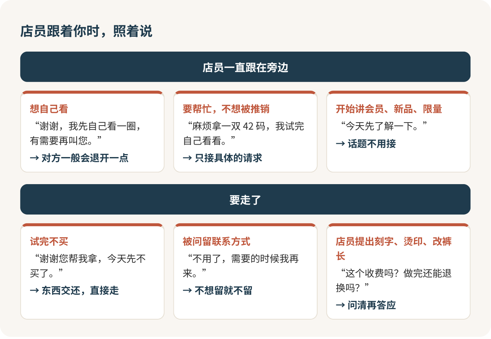

# 奢侈品店：只看不买，没人有资格给你脸色

只想看看，就大大方方走进去，看完说声谢谢就走。你不欠任何人一个“为什么不买”。店员要是给你脸色，丢人的是他。真正要小心的只有一件事：店员热情提出帮你做的刻字、烫印、改裤长，一开工就退不回去，答应之前先问价。

## 门口那一下最难

很多人怕的不是贵，是门口那一下。玻璃门、黑西装、站在门边的保安，还有你一进门就转过来的几道目光，脑子里立刻开始演：他是不是一眼看出我买不起？我这身衣服是不是太随便了？

没有人能从一身衣服看出一个人的钱包。穿卫衣运动鞋进门、走的时候刷掉几万块的顾客，店员见得多了。上道的店员不会以貌取人，因为以貌取人的代价他们比你清楚。

门口排队，或者被拦一下，问一句就行：

> 您好，我想进去看看，需要排队还是可以直接进？

有的大牌能在小程序里约到店，约了会有人专门接待你，这是一项服务，不是进门的门票，不约照样能进。

你在学校书店翻了二十分钟的书又放回去，没有人会要你解释。精品店的门看着重，道理是一样的：你有权挑，有权比，有权不买，这是写进消费者权益保护法里的。

## 店员问“想看点什么”，给个方向

“随便看看”会让对话一下子卡住，给个大方向反而轻松：“想看看小皮具”“想闻一下木质调的香水”“想看看今年的跑鞋”。预算不用说，今天不买的理由也不用交代。

三种店气氛差很多。奢侈品精品店人少店员多，一对一接待是常态，被注意到很正常；运动品牌店就是普通商场店，自己拿自己试；商场一楼的香水彩妆柜台挨着通道，停下来闻一闻再走开，谁都不会多看你一眼。第一次想练胆，从香水柜台开始，这是我的推荐。

招牌上那些字母怎么认，看[认识奢侈品牌：先认招牌，再谈派系](奢侈品牌.md)和[运动和户外品牌：按用途买，别按标志买](运动户外品牌.md)。

## 店员一直跟着？把节奏拿回来

这是逛精品店最大的压力。店员跟在旁边，多半是店里的服务要求，随时准备帮你拿尺码、开柜子，未必是在盯你。但你不自在，就说出来：

> 谢谢，我先自己看一圈，有需要再叫您。

说完对方一般会退开一点。需要帮忙又不想被推销，就把要求说具体：“麻烦拿一双 42 码，我试完自己看看。”开始介绍会员、新品、限量款，笑着回一句“今天先了解一下”，话题不用接。

真遇上冷脸、白眼、阴阳怪气的店员，别往心里去，也别为了争口气当场刷卡。转身去下一家，或者换一个店员问。为了店员一个眼神买下一个包，是整个商场里最贵的智商税。

## 想试就开口，别自己伸手

玻璃柜里的东西，先说一声，让店员帮你拿：

> 这款能试一下吗？我想看看上身效果。

试香这样最不吃亏：先喷在试香纸上，喜欢再喷手腕内侧，出去走一圈，过二三十分钟再闻，刚喷上和后来留下的味道常常是两回事。一次试两三款就够，再多鼻子就糊了。店员要往你身上喷，说一句“先在纸上试就好”。

试鞋穿平时运动的袜子去，跑鞋可以问一句能不能在店里小跑几步。

## 免费和收费，界线在“服务”

进店、看、试穿、试香，统统零元。刻字、烫印、改裤长、化妆造型、为调货交的订金，是另一回事：可能免费，可能收费，而且做完往往不能退。同样是刻字，有的牌子免费，有的收一百块，刻完连香水带刻字费都不退不换。改裤长也一样，有的运动品牌免费改，有的要看门店。

没有统一答案，只能在那一家、那一件上问：

> 这个服务收费吗？多少钱？做完还能退换吗？

要交订金帮你调货，问清能不能退，最好让店员写在小票或者聊天记录里。稀里糊涂被拉着做了服务、事后才说要钱，当场请对方拿出价目，你有权拒绝强卖。

## 想拍照，先问一句

能不能拍，每家不一样，先问：

> 我想拍一下这款的细节发给朋友看，可以吗？

可以就只拍商品，别把别的顾客和店员拍进去。不行就请店员把型号、颜色、价格写给你，回去在官网或小程序搜同款。

两个人一起逛会轻松很多，一个试，一个看效果、记价格。比价出了门再说，别在店里大声嚷嚷“网上便宜一半”。

## 走的时候，一句谢谢就够

试完不买，把东西交还店员：

> 谢谢您帮我拿，今天先不买了。

不用编理由，也不用拿“我再考虑考虑”拖着。试过的衣服叠不叠都行，交给店员；试香纸可以带走。店员再推荐别的，重复一句“今天先不买”就够了。问你要不要留联系方式，不想留就说“不用了，需要的时候我再来”。

第一次，就去商场一楼找个香水柜台，闻三款，拿两张试香纸，说声谢谢走出来。走过这一回，下次推哪扇门都不难了。

## 参考

- [中华人民共和国消费者权益保护法](http://www.npc.gov.cn/zgrdw/npc/xinwen/2013-10/26/content_1811773.htm)
- [如何预约专卖店服务（路易威登官网）](https://www.louisvuitton.cn/zhs-cn/faq/services/how-to-make-an-appointment-in-store-china)
- [个性化定制（古驰官网）](http://www.gucci.cn/zh/st/capsule/monogramming?navigation.code=0-11-5)
- [线上服务使用条款（祖·玛珑官网）](https://m.jomalone.com.cn/terms-conditions)
- [Hemming 修改服务（lululemon 香港官网）](https://www.lululemon.com.hk/en-hk/content/hemming/hemming.html)

<!-- NAV:BEGIN -->
---

上一课：[按摩和洗浴：不舒服就喊停](../3-出门玩/按摩与洗浴.md) · [回目录](../../README.md) · 下一课：[认识奢侈品牌：先认招牌，再谈派系](奢侈品牌.md)
<!-- NAV:END -->
