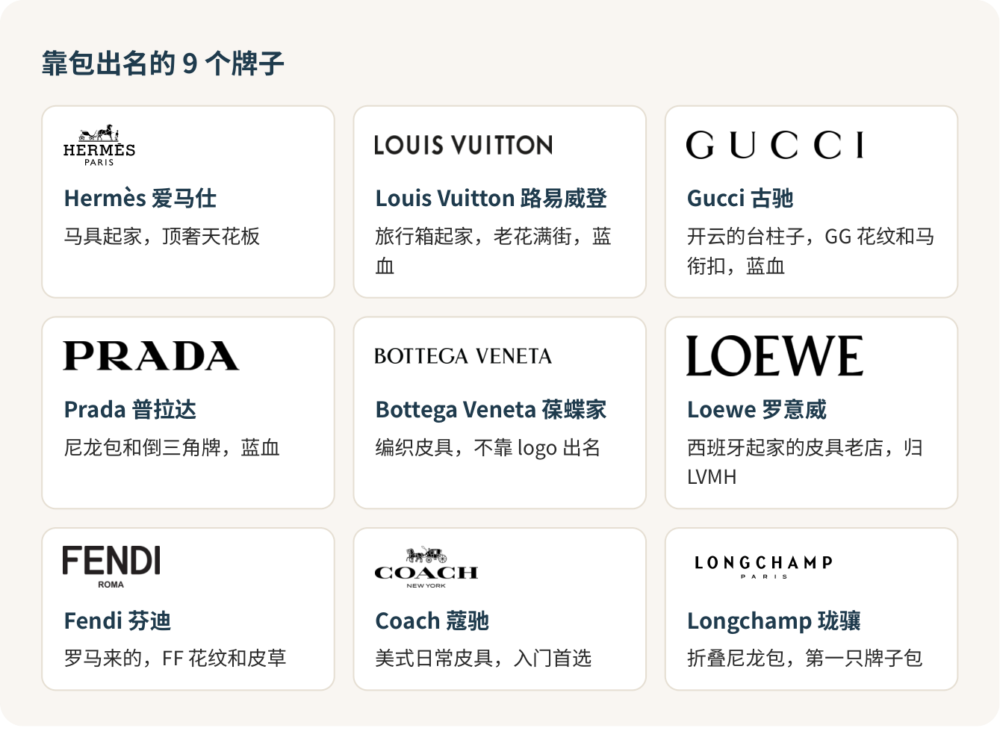
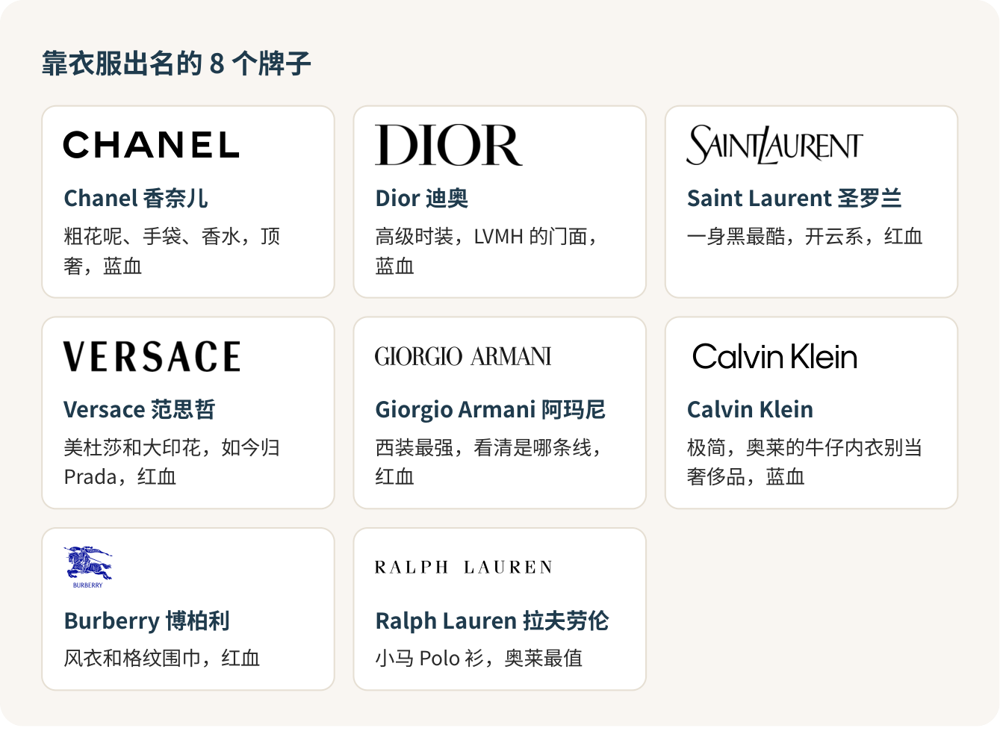

# 认识奢侈品牌：先认招牌，再谈派系

认奢侈品牌，别去背品牌史。先做到看见招牌能说出它卖什么，再弄清眼前这块招牌挂的是哪条线。派系、集团、红血蓝血，是认熟以后拿来聊天的谈资。顺序一反，你就会被名词绕晕，还会在奥莱买错东西。

## 第一次逛奥莱，晕是正常的

第一次去奥莱的人，十个有八个会在第一排店前面晕掉：一溜黑底白字，字母挤在一起，有的认得一半，有的念都不会念。朋友在旁边说“这是开云系”“那个算轻奢”，你跟着点头，其实一个都没对上。

没关系。这跟大一开学认食堂窗口一样，先记住每个窗口卖什么，吃过两回就熟了。

## 先把十七块招牌认熟

我把常见的十七个牌子分成两拨：靠包出名的，和靠衣服出名的。分法只为好记，香奈儿、迪奥的包一样出名，古驰、普拉达也做衣服。每张卡只记一句话。

老花、格纹、编织、金属三角牌，这些长在商品上的图案各有各的主人，但满身老花不等于是真货，满身编织也未必是葆蝶家。认牌认招牌，别认图案。

## 我的分层：四档就够用

给这些牌子排个大致位置，我分四档。

**顶奢**：爱马仕、香奈儿。天花板。别家常见的包一两万，它们的包从三万往上走，最出名的那几款连官网都不卖。对大学生来说，它们是用来认识的，不是用来买的。

**奢侈主线**：路易威登、迪奥、古驰、普拉达、圣罗兰、芬迪、罗意威、葆蝶家、博柏利、范思哲。大家嘴里的“大牌”就是这一档，一只常见款的包一万五上下。

**设计师成衣**：Polo Ralph Lauren、Max Mara、Theory、Sandro、Maje 这些。主要卖衣服，衣服做得好，包不是它们的强项，买它们就买衣服。

**入门轻奢**：蔻驰、Michael Kors、Kate Spade，还有珑骧的折叠包。一千出头就能拿下。第一只“牌子包”从这里开始，我觉得刚刚好。

档和档之间不是一堵墙。古驰一只超小手袋可以比路易威登的常规款还便宜；同一个牌子的口红和手袋，根本不在一个世界。拿专柜口红的价去判断一个牌子的包贵不贵，是最常见的误会。

## 派系，说白了就是谁家的

朋友嘴里的“派系”，多半在说集团，也就是背后是谁在经营。记住三家大户就够了。

LVMH，最大的那一家，路易威登、迪奥、芬迪、罗意威都是它的。大家爱叫它“法系大户”，可罗意威其实是西班牙起家的。

开云，古驰、圣罗兰、葆蝶家、巴黎世家都在这里，四家里最会玩潮流的一家。

Prada 集团，普拉达、缪缪，现在范思哲也归了它。网上很多老图还把范思哲画在别家名下，那张图过期了。

另外两个美国来的：蔻驰背后是 Tapestry，Calvin Klein 背后是 PVH。

同一个集团的牌子，档次和风格可以差得很远，就像一家公司承包了食堂好几个窗口，盖饭和麻辣烫不会因为同一个老板就变成一个味儿。知道集团是为了听懂别人聊天，拿它判断哪个包更好，用错了地方。

## 红血蓝血：听得懂就行

“蓝血”“红血”是时尚圈和网友传出来的叫法，没有哪个机构发过正式名单，但聊天时人人都在用。常见的说法是：

**六大蓝血**：香奈儿、迪奥、路易威登、古驰、普拉达、Calvin Klein（指它的秀场高端线，跟奥莱里的牛仔内衣没关系）。

**八大红血**：爱马仕、阿玛尼、博柏利、范思哲、华伦天奴、圣罗兰、纪梵希、浪凡。

你会发现爱马仕在红血、CK 在蓝血，可见这份名单跟价格、质量都不挂钩，“蓝”也不是 logo 的颜色。我的态度很明确：知道它，是为了别人说起时你接得住；拿它决定买什么，就是被带了节奏。

## 同一个牌子，先分清是哪条线

这是在奥莱最容易栽的地方。

阿玛尼至少三条线：Giorgio Armani 是高端正装，Emporio Armani 是鹰标的年轻线，EA7 偏运动。拉夫劳伦也一样，Polo Ralph Lauren 是大家熟的那只小马，Purple Label 是贵得多的高端线。CK 的牛仔和内衣在奥莱最常见，跟秀场上的 Calvin Klein Collection 是两回事，当基础款买很好，当奢侈品买就亏了。

看招牌全称，比看 logo 重要。招牌上带 OUTLET 的，就是奥莱专门的门店。

## 去奥莱，别指望四大天王

爱马仕、香奈儿、路易威登、迪奥，这四家不开奥莱店，北京、天津、上海几家大奥莱里都找不到它们。奥莱里谁跟你说有这几家的“内部货”“尾单”，掉头就走。

奥莱里我觉得最值的，是拉夫劳伦的 Polo 衫和衬衫、博柏利的围巾、珑骧的折叠包、蔻驰的小皮具：款式经典，不怕过季，打完折确实划算。最容易买亏的，是满身大 logo 的“爆款”，奥莱里这类多半是过季的，或者专门给奥莱做的款。

进店做三件事：看清招牌全称；拍下吊牌上的款号，回品牌官网搜一下，搜得到同款才谈便宜了多少；付钱前问一句：

> 这件是正价店同款，还是奥莱专门的款？几天内能退换？

门口写的“低至两折”，说的是最低那一档，你手里那件多半不是。

出发前一晚，把那家奥莱官网的品牌目录翻一遍，在认得的牌子上画个圈。到了先去圈里的店，看完再随便逛，钱包和腿都轻松。

## 参考

- [八达岭奥莱 品牌列表](https://www.badaling-outlets.com/index.php?m=content&c=index&a=lists&catid=10)
- [佛罗伦萨小镇京津 品牌目录](https://www.florentiavillage.com/zh-hans/jingjin/brands)
- [LVMH 时装与皮具品牌](https://www.lvmh.com/en/our-maisons/fashion-leather-good)
- [开云集团旗下品牌](https://www.kering.com/en/houses/)
- [Prada Group 简介](https://www.pradagroup.com/en/group/group-profile.html)
- [时尚圈知多少——六大蓝血？八大红血？（北京时装设计师协会）](https://www.sohu.com/a/278392556_100200076)

<!-- NAV:BEGIN -->
---

上一课：[奢侈品店：只看不买，没人有资格给你脸色](奢侈品店.md) · [回目录](../../README.md) · 下一课：[运动和户外品牌：按用途买，别按标志买](运动户外品牌.md)
<!-- NAV:END -->
