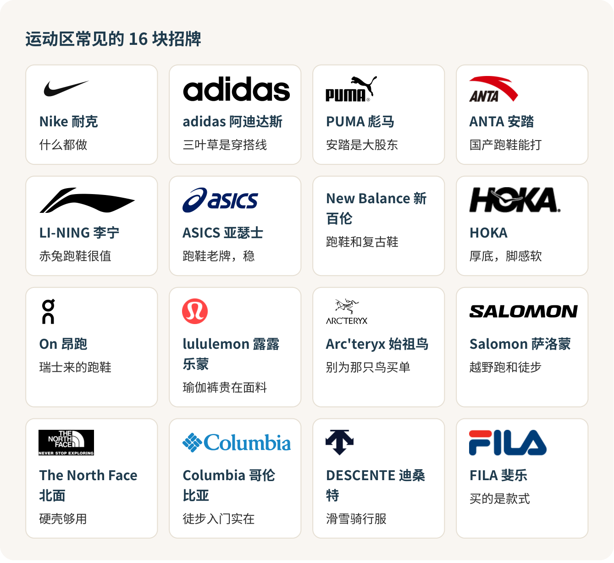
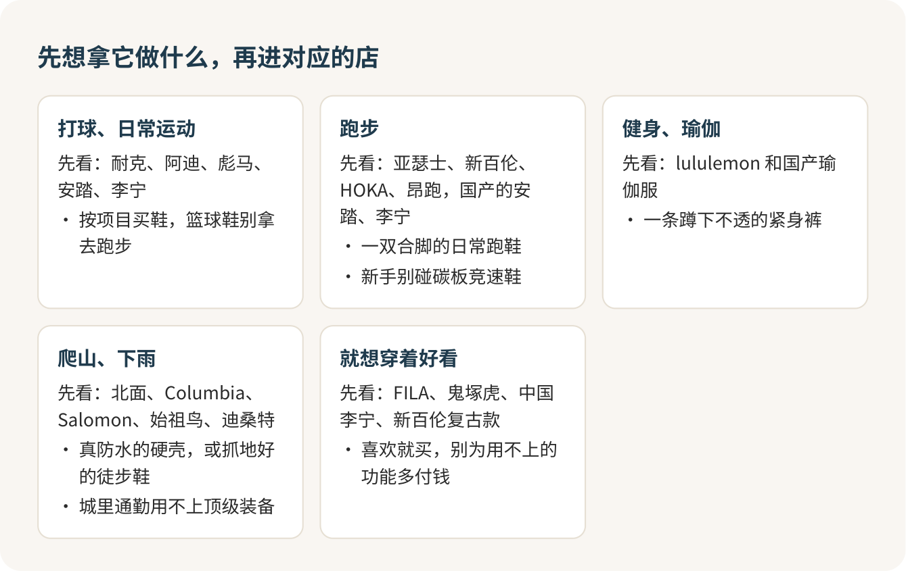

# 运动和户外品牌：按用途买，别按标志买

买运动装备，先想清楚拿它干什么，再去认牌子。每个大牌都是什么都做，同一面墙上的鞋能差出好几百，从标志出发去挑，最容易买到一双好看但不合用的鞋。跑步就买跑鞋，下雨就买真防水的壳，日常穿就挑自己喜欢的。钱花在用途上，不花在那个标上。

## 运动区的招牌，比时装区还难认

逛到奥莱的运动区，一路 ON、SALOMON、DESCENTE，还有一只看不出是什么的鸟，缩写和外文比时装区还密。这有点像开学第一周的社团招新，每个摊位都挂着大大的缩写，你得先问清它是打球的还是爬山的，才知道该不该停下来。

先把常见的十六块招牌认个脸熟，每块只记一句话。

## 先分五组，只在组里比

认完脸，把它们按“拿来干什么”重新分一遍。这张图比上一张有用得多。

打球、日常运动，看耐克、阿迪、彪马、安踏、李宁。这几家什么都做，所以要按项目买：篮球鞋别拿去跑步，跑鞋别拿去打球，崴了脚不怪鞋。

跑步，看亚瑟士、新百伦、HOKA、昂跑，国产的安踏、李宁也很能打。第一双跑鞋只要一个标准：合脚，跑起来舒服，日常训练款就够了。国产好跑鞋四五百就有，国外几家的日常款一千出头。刚开始跑，碳板竞速鞋别碰，那是比赛冲成绩用的，你现在用不上，买了就是智商税。

健身、瑜伽，lululemon 是绕不开的名字，一条紧身裤八百多。它贵有贵的道理，面料和版型确实好。每周练三次以上，这钱花得值；一个月去两回健身房，国产瑜伽服完全够用。

爬山、下雨，看北面、Columbia、Salomon、始祖鸟、迪桑特。真要进山，买一件真防水的硬壳，或者一双抓地好的徒步鞋，这钱必须花。可要是只在城里骑车上学挡个雨，一千出头的北面硬壳绰绰有余；花几倍的钱穿始祖鸟去挤地铁，你买的主要是那只鸟。

只想穿着好看，看 FILA、鬼塚虎、中国李宁、新百伦的复古款。喜欢就买，这一组买的就是款式，别再为用不上的功能多付钱。

## 进店先报用途，别报牌子

运动品牌店是最好进的店：货架敞开，鞋盒堆在那儿，自己拿自己试，没人管你。让人心虚的是那几家装修得像精品店的户外和瑜伽店，店员一走过来问“今天想看点什么”，很多人下意识回一句“随便看看”，然后被一路跟着，越看越慌。

直接报用途就好：

> 想找一件下雨骑车上学穿的外套，别太贵。

店员听得懂用途，推荐反而准。你说不出用途，他能推的就只剩最贵的新款。

## 同一个牌子，价钱也能差一倍

“运动品牌一分钱一分货”，这话只对了一半。同样叫防水硬壳，北面自家两件就能差出一倍；一双国产碳板竞速鞋，可能比进口的日常跑鞋还便宜。价格里有功能，也有牌子、代数、渠道和联名。

所以比价只在同一类东西、同一代、同一个渠道里比。鞋名后面那个数字是代数，换一代脚感和价格都会变。官网上那个划线价是建议零售价，最后付多少看结算页。联名款单独定价，多出来的那部分是情怀钱，喜欢就付，别骗自己说是功能。

“北面贵”“耐克便宜”这种整个牌子的说法，落到具体一件上经常不成立。

## 背后是谁家的，知道就行

这几年最会买的是安踏。FILA 和迪桑特在国内的生意是安踏在做，始祖鸟、Salomon 背后那家公司，安踏是最大股东，彪马的第一大股东现在也是安踏。HOKA 和 UGG 是一家的，北面和 Vans 是一家的。

这些拿来跟朋友聊天挺有意思，但招牌背后是谁，不改变一双鞋合不合你的脚。

## 试穿：别站着试

试跑鞋，穿上平时跑步的袜子，两只都穿上，在店里小跑几步，脚趾前面要留一指的空。试硬壳，里面套上你冬天会穿的毛衣，抬手、弯腰，看袖口会不会缩上去、后腰会不会露出来。试紧身裤，蹲下去对着镜子看透不透。

店员说“这款功能更好”，可以照着问：

> 你说的更好，是更防水、更透气，还是更轻？吊牌上写的是哪个？

问到具体，好坏自己就看出来了。

## 在奥莱，拿款号说话

奥莱的价钱比官网低多少，靠的是同一个款号。看中了就拍下吊牌上的款号，回品牌官网或者小程序搜一下，搜得到同款，才知道到底便宜了多少。付钱前再问一句：

> 这双是正价店同款吗？几天内能退换？

官网的退换规则管不到奥莱门店，以店里说的和小票为准。

下次进运动区之前，先在手机备忘录里写一句“我要拿它干什么”。写不出来，就先别买。

## 参考

- [八达岭奥莱 品牌列表](https://www.badaling-outlets.com/index.php?m=content&c=index&a=lists&catid=10)
- [安踏体育 多品牌策略](https://ir.anta.com/tc/brand.php)
- [Amer Sports 旗下品牌](https://www.amersports.com/brands/)
- [lululemon 中国官网 Align 系列](https://www.lululemon.cn/active-107.html)
- [北面 Valley View 防水硬壳外套](https://www.thenorthface.com.cn/index.php/product-87048.html)
- [李宁官方商城 赤兔跑鞋](https://store.lining.com/goods/list?key=赤兔%20男%20跑鞋&searchSource=manual_search)

<!-- NAV:BEGIN -->
---

上一课：[认识奢侈品牌：先认招牌，再谈派系](奢侈品牌.md) · [回目录](../../README.md)
<!-- NAV:END -->
