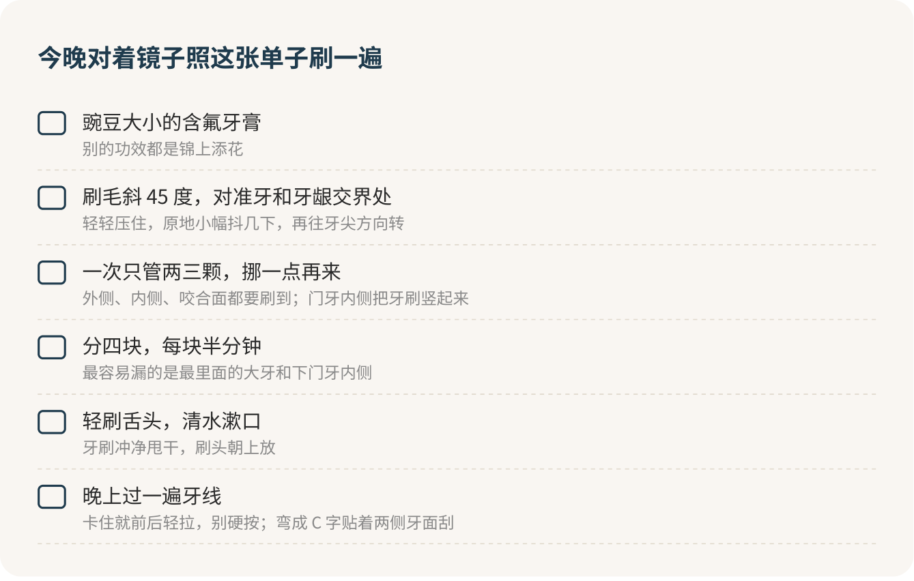

你缺的不是一支电动牙刷，是一盒牙线。刷毛斜着对准牙龈边，每次刷够两分钟，晚上再过一遍牙线，一个月花不到十块钱，半年后去洗牙时医生的脸色会好看很多。贵牙膏、网红电动牙刷，统统往后排。

牙缝像宿舍床底和柜子之间那道缝。地天天扫，那道缝里的灰照样越积越厚，扫把伸不进去，得专门拿东西去掏。牙刷就是那把扫把，两颗牙挨着的那一面它碰不到，牙线才是专门去掏的那根东西。蛀牙、牙龈出血、口气，很多都是从这道缝里长出来的。

## 出血了，反而要接着刷

十个人里有八个，牙线棒买回来用两晚，看到一点血就吓住了，盒子从此在洗手台角落吃灰。我的态度正好反过来：哪里出血，哪里就更要轻轻地刷、轻轻地过牙线。

道理很简单。牙龈出血多半是那一圈菌斑没清干净，牙龈发炎、变得又红又软，一碰就出血。你越躲着那块，菌斑越多，血越顽固。换对刷法、加上牙线，坚持一两周，你会看到出血一天比一天少。

有一条底线要记住：牙龈又红又肿、牙缝越来越大、牙齿开始松，或者某颗牙自己会疼、夜里疼，这已经超出刷牙能管的范围，别再自己琢磨，直接去口腔科。喝冷水时某颗牙酸一下，多半是牙根附近被磨薄了，先换软毛牙刷，改掉横着刷的习惯。

## 横着拉锯，是在锯自己的牙

很多人刷牙像锯木头，用硬毛刷，左右大力来回。长年这么刷，靠近牙龈的地方会被磨出一道小缺口，牙从此怕冷怕酸。这个习惯必须改。

换成巴氏刷牙法，听着唬人，做起来不难：挤一颗豌豆大的含氟牙膏，刷毛斜 45 度对准牙和牙龈交界的地方，轻轻压住，原地小幅抖几下，再往牙尖方向转一下，上牙往下转，下牙往上转。一次只管两三颗，挪一点，再来。外侧、内侧、咬合面都要刷到，门牙内侧把牙刷竖起来用刷头。

两分钟盯着整口牙数秒很难坚持。把嘴分成左上、右上、左下、右下四块，一块半分钟，四块刷完正好两分钟，比盯着秒表轻松得多。最后轻刷一下舌头，口气会好不少。

今晚对着镜子照这个顺序刷一遍，你多半会发现，最里面那颗大牙和下门牙内侧，这些年几乎没被认真刷过。

## 牙线，给它三个星期

第一次用牙线，样子是挺狼狈的：对着镜子张大嘴，手指塞进去找不着位置，线卡在两颗牙中间进不去也出不来，弄完一口牙十分钟过去了，还带了点血。没关系，所有人第一周都是这样，手熟了两三分钟就够。

卷轴牙线取一臂长，两头缠在中指上，用拇指和食指捏着，中间留短短一截。滑进牙缝时卡住了，就前后轻轻拉几下让它自己下去，千万别使劲往下按，那一下切到牙龈是真疼。进去以后把线弯成 C 字，贴着一侧牙面上下刮几下，再换另一侧。

嫌卷轴麻烦，就用牙线棒，一样管用，揣兜里出门也方便。先刷牙还是先过牙线，医生们说法不一，不值得纠结，每天晚上用上就行。给它三个星期，三个星期后你还觉得用不惯，再说放弃的事。我赌你不会放弃，因为那时你会发现嘴里清爽得多。

> 我刷牙总在这几颗牙出血，是刷法问题，还是已经有牙石了？

> 我的牙缝适合用牙线、牙线棒，还是牙缝刷？我最容易漏哪几处？

戴着牙套、牙缝比较大、装了牙桥的，医生可能让你换牙缝刷或冲牙器，这时听医生的。

## 电动牙刷和贵牙膏，往后排

电动牙刷可以买，不买也完全没问题。它替你抖，但替不了你对准角度、刷够时间。手动牙刷刷到每个牙面，效果一样好。生活费紧的时候，这笔钱我建议先留着。

牙膏我只看一件事：含不含氟。含氟就够了，脱敏、草本、美白，都不是药，治不了已经有的洞。网上写着“修复蛀洞”“牙齿再生”的牙膏，我直接贴标签：智商税。牙膏按规定不能宣称治病，敢这么写的，要么在打擦边球，要么根本不是正经牙膏。

牙刷选小头软毛的，三个月换一支，刷毛炸开了就提前换。

钱算下来很可怜：一支十块钱的牙刷用三个月，一管几块钱的含氟牙膏用两个月，一盒五块钱左右的牙线棒五十支，一天一支，一个月加起来不到十块。换成好看包装的牙膏，一个月也就多花五六块，换来的只是另一个牌子。这几块钱我宁可省下来，把那两分钟刷够。

## 刷得再好，也要去洗牙

刷牙加牙线做得再好，总有一点菌斑漏网，时间一长变成硬邦邦的牙石，牙刷拿它毫无办法，只能交给洗牙。所以每天刷好、每年洗一次，两件事缺一不可。洗牙怎么约、怕不怕，接着看[洗牙那一篇](jingzhi-02.md)；已经摸到黑点、喝冷水会酸的，看[蛀牙那一篇](jingzhi-03.md)。

> 刷牙时这颗牙会酸，是磨出缺口了吗？要处理，还是先换软毛牙刷观察？

今晚刷完牙，把那盒牙线棒从抽屉最里面翻出来，就从最里面那颗大牙开始。

## 参考

- [北京市卫健委：牙齿酸痛、牙龈出血，做好这件事解决一切烦恼](https://wjw.beijing.gov.cn/bmfw_20143/jkzs/jksh/202112/t20211208_2556853.html)
- [北京市卫健委：世界口腔健康日｜探索口腔微世界，守护全身大健康](https://wjw.beijing.gov.cn/bmfw_20143/jkzs/jksh/202503/t20250320_4040116.html)
- [北京市卫生健康委员会：记住这几点 守护你的口腔健康](https://www.beijing.gov.cn/fuwu/bmfw/jhsyfwzdzx/2025qmjk/jbyf/202509/t20250918_4204800.html)
- [北医人爱科普：口腔健康是一种文明的标志](https://bynews.bjmu.edu.cn/tszt/byrakp/778e71d0d1a4442da7f2435588a0f4ec.htm)
- [四川大学华西口腔医院：不要再继续误解洗牙了](https://hxkq.org/Html/News/Articles/14059.html)
- [国家市场监督管理总局：牙膏监督管理办法](https://www.gov.cn/zhengce/202305/content_6857952.htm)
