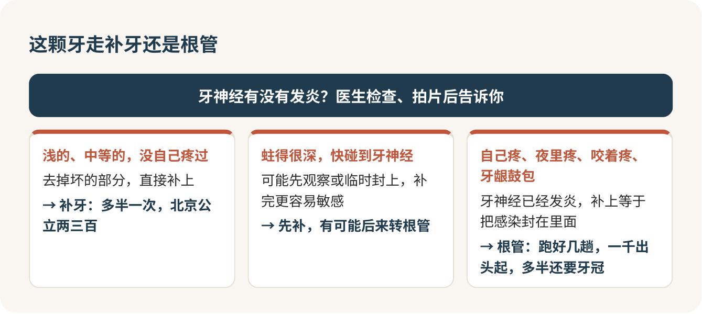

发现蛀牙，这周就去补，别等它疼。在北京的公立医院，补一颗牙两三百块，一次搞定；拖到牙神经发炎，就得做根管，一颗大牙一千出头起步，要跑好几趟，做完多半还得再加一个牙冠。疼了才去，是看牙最贵、最遭罪的那种去法。

我常拿苹果上的烂点来想这件事。烂得浅，削掉一小块，剩下的照样脆甜；烂到了果核，就得把芯整个挖掉，再想办法把外面那层壳保住。补牙是前一种，根管是后一种。烂点到底有多深，从表面看不出来，只有越早去，你越可能停在前一种。

## 不疼，不代表没事

蛀牙的信号往往是你自己先发现的：镜子里某颗牙上有个黑点，那个地方越来越爱塞菜，喝冰可乐时某颗牙突然酸一下。很多人这时候的想法是：“又不疼，等放假回家再说。”

这是最常见、也最贵的错误。蛀牙不会自己好，只会往里走。更要命的是，有的牙是从发炎拖成了慢性，表面看反而不疼了，这种牙如果直接补上，等于把感染封在了里面，过阵子疼起来更麻烦。所以不疼的洞，也要让医生看过再说。

底线就一句：牙自己会疼、夜里疼到睡不着、咬东西疼，或者脸肿了、牙龈上鼓了个包，当天就去，挂急诊也行，别等周末。

## 先搞清楚：这颗牙走哪条路

去了医院，别一开口就问“补牙多少钱”。先问这颗牙走的是补牙这条路，还是根管那条路，两条路的钱、次数、疼法完全不一样。

> 这颗牙是浅龋、中龋还是深龋？现在补就行，还是已经要做根管了？

浅的、中等的、又没有自己疼过的，去掉坏的部分直接补，多半一次完事。蛀得很深、快碰到牙神经的，医生可能先观察或者先临时封上，补完以后一段时间里也更容易敏感。已经自己疼过的，八成要走根管。

## 钻牙那几分钟

很多人怕补牙，怕的其实是那个声音。躺下，灯一开，钻头一响，心跳先上去了。我想告诉你：浅的蛀牙钻起来基本不疼，主要是震动、声音和酸；蛀得越深、越靠近牙神经，才越可能疼。

打不打麻药，开始前直接问，别硬扛：

> 今天需要打麻药吗？我比较怕疼。

钻的过程中疼了，就举手，医生会停下来或者补一针麻药。千万别突然闭嘴或者扭头，钻头还在你嘴里。补完医生会让你咬一张蓝色的纸，看看补得高不高。觉得硌、觉得这颗牙先碰到，当场说出来，医生磨一下就好。

## 补完咬着高，必须回去调

回到宿舍，麻药没退之前别吃东西，小心咬到嘴唇。之后几天，这颗牙碰冷碰热会有点敏感，这是正常的，先用另一边吃饭，大概两周会好。

有一种疼不能等它自己好：一咬东西就是这颗牙先碰到，或者这一边咬上了、另一边咬不上。这是补高了，硬扛只会越来越疼，必须回医院调，调一下几分钟的事，不用不好意思。如果疼得越来越厉害，或者牙龈鼓了包，说明牙神经还是没保住，回去找医生，多半要转根管。

> 补完以后咬东西觉得高，我需要回来调吗？要等几天再判断？

## 根管值得做，但别半途而废

听到“根管”很多人第一反应是：干脆拔了算了。我的态度很明确：能保住自己的牙，就保。根管做好了，这颗牙还能接着用；拔掉以后再想补上一颗，花的钱和功夫只会更多。根管也不是百分百成功，根管长得复杂的，偶尔要返工，但这不改变我的选择。

根管是一个疗程：先把发炎的牙神经清掉减压，再把根管里面清干净、放药消毒，最后把根管封起来。中间要跑好几趟。最容易犯的错，是第一次放完药不疼了，就觉得好了，再也不去。药是有疗程的，不疼也得按时回去，否则前面白做。

每次处理完疼两三天是正常反应，越来越疼、脸肿起来就提前复诊。治疗期间别用这颗牙啃硬东西。根管做完的牙会变脆，咬到硬骨头可能裂开，所以医生多半会建议戴个牙冠。牙冠是另一笔钱，开始之前就问清楚：

> 做根管大概要来几次？做完要不要牙冠？牙冠大概多少钱？

## 报价不一样，先问是哪一种算法

同一颗牙，你在不同地方可能听到几十块、两三百、七八百的报价，而且都不一定是宰你。有的医院按“洞”算，有的按“牙”算，民营诊所按材料品牌算，还有的打包成套餐。北京公立医院补一颗是两三百，蛀到两个面以上会加钱，到五百左右。

所以拿到报价，我一定会多问一句：这个价包括什么，什么情况下会加钱。蛀了几个面、有几根根管，往往要把牙打开才完全确定，钱一次报不准很正常，关键是加钱之前先跟你说。

> 补这颗牙涉及几个牙面？用什么材料？麻药另外收钱吗？

## 补过的牙，有几件事要认

补过的牙就不是原装的了。坏的部分必须磨掉，补得越大，剩下的越薄；做过根管的牙更脆。深的蛀牙补完，过一段时间转成根管，也不是医生没补好，是牙神经有没有保住，有时候要过一阵才看得清。

这些都在告诉你同一件事：越早补，磨掉的越少，花的越少，受的罪也越少。想少蛀牙，回去看[刷牙那一篇](jingzhi-01.md)，牙缝是重灾区；每年[洗牙](jingzhi-02.md)时让医生顺便检查一遍，小洞在那时候发现最划算。

补完那天回到宿舍，先用另一边吃饭，晚上咬一咬，留意这颗牙是不是第一个碰到。

## 参考

- [北京市卫健委：口腔治疗误区篇——根管治疗](https://wjw.beijing.gov.cn/bmfw_20143/jkzs/jksh/202411/t20241118_3944347.html)
- [烟台市口腔医院：补牙的时候，大夫为什么要先钻一下？](https://www.yantai.gov.cn/art/2023/1/17/art_67230_3091212.html)
- [北京市卫健委：补牙后出现牙齿疼痛是怎么回事？](https://wjw.beijing.gov.cn/bmfw_20143/jkzs/jksh/202111/t20211130_2549268.html)
- [北京市医疗保障局：关于调整规范综合诊查等11类医疗服务价格项目的通知](https://www.beijing.gov.cn/zhengce/zhengcefagui/202604/t20260415_4582642.html)
- [北京市卫健委：世界口腔健康日科普](https://wjw.beijing.gov.cn/bmfw_20143/jkzs/jksh/202503/t20250320_4040116.html)
