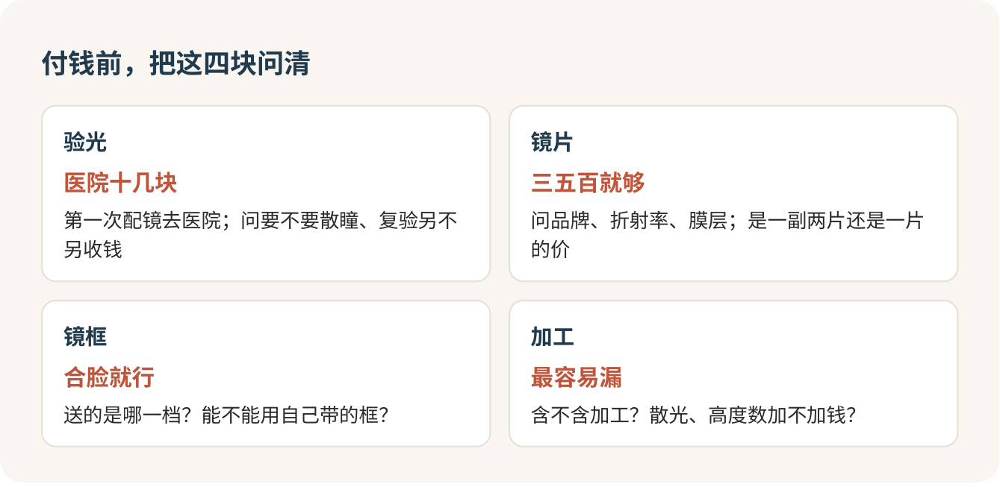

配眼镜这件事，钱要花对地方：验光值得多跑一趟医院，镜片买中档就够，镜框随便挑个合脸的，防蓝光一分钱都别加。一副眼镜戴着舒不舒服，八成是那张处方决定的，剩下两成是镜片，镜框是什么牌子，跟你的眼睛没关系。

## 进店那一刻最容易被带着走

第一次自己去配眼镜，很多人是被店员领着走完全程的。一进门先让你在电脑验光机前看那个热气球，三十秒出一串数字，然后直接带你去镜框墙，“这款是新到的”“这个牌子学生戴得多”，等你回过神来，已经坐在柜台前听人报镜片价了，一千二、两千四，后面还跟着“今天有活动”。

紧张很正常。你看不懂那张小纸条，也不知道一副眼镜该花多少钱，只能对方说什么就点头。我想告诉你的是，配眼镜的顺序完全可以由你来定：先把度数验准，再挑镜框，最后才谈镜片和价钱。你是来花钱的，店员着急，你不用急。

## 第一次配镜，去医院验光

电脑验光打出来那串数，只是个起点。真正的处方，是验光师给你戴上试镜架、一片一片插镜片，一边问“这样清楚还是那样清楚”，一边跟你一起定下来的。医院眼科和视光中心还会先看看你的眼睛本身有没有毛病，必要时给你散瞳，排除眼睛自己“使劲”造成的假性度数。

这一步我给它贴个标签：必做。尤其是这三种时候：第一次配镜；一年里度数涨了不少；戴着旧眼镜总觉得累、头疼。度数好几年没变、只是镜片花了想换新，眼镜店的验光够用。

医院验光便宜得出乎意料，公立医院验一次也就十几块，加个挂号费。贵的从来不是验光，是你在店里被推销的那些东西。

散瞳那天要多留点时间。药效没退之前怕光、看近处模糊，别排论文和考试，有的医院还要你隔天回去复验。挂号时问一句就行：

> 我第一次配镜，想做医学验光。要不要散瞳？散瞳以后几个小时能看清手机？

插片的时候，把自己怎么用眼说出来。看得最清楚的度数不一定戴着最舒服，就像晚上在宿舍把台灯开到最亮，字是清楚，两个小时后眼睛先受不了。

> 我一天对着电脑七八个小时，这个度数是按最清楚开的，还是按戴着舒服开的？

## 那张小纸条，看懂三格就够

验光单上挤着一堆缩写，你只要认三样。S 是近视度数，负号代表近视，−3.50 就是三百五十度。C 是散光，后面跟着的 A 是散光的方向，它不代表度数大小，别被那个“180”吓到。PD 是瞳距，两只眼睛中心之间的距离，网上配镜一定要报准。

如果 C 那一格空着，问一句是没散光还是漏写了。就这么多，剩下的交给验光师。

## 镜框：先合脸，再好看

近视镜片中间薄、边缘厚，镜框越宽，边缘越厚越重。所以度数高的人，别碰那种大到遮半张脸的框，同样五百度，小框配普通折射率，可能比大框配高折射率还薄还轻。

挑框只看三件事：镜框宽度跟脸差不多宽；鼻托稳，低头不往下滑；眼睛的位置大致落在镜片中间。做到这三条，几十块的框和几百块的框戴在脸上差别不大。名牌镜框是给愿意为设计买单的人准备的，买了不亏，没买也一点不寒碜。

店里说“送镜框”的时候，问清楚送的是哪一档、能不能换成你自己带的框。很多人家里抽屉里就躺着一副还能用的旧框。

## 镜片：中档就够，别为名字付钱

镜片的价钱主要看三样：品牌、折射率、膜层。

折射率越高越薄，也越贵。三百度以下普通的 1.56 就行，六百度以内 1.60 够用，再往上才考虑 1.67。这是个大概的分档，散光大、镜框宽，边缘都会厚一些，让配镜师按你的处方和镜框帮你估。

膜层就是那些听起来很厉害的系列名，什么钻晶、铂金，说的是减反射、耐磨、防污这些涂层的档次。名字记不住没关系，问一句耐磨有没有质保就够了。

> 按我的度数和这副框，1.60 和 1.67 的边缘大概差多厚？差多少钱？

防蓝光，我直接给它贴标签：智商税。美国眼科学会明确说过，防蓝光眼镜改善不了看屏幕的眼疲劳，他们不推荐。眼睛累，管用的是每看二十分钟屏幕，抬头看六米外的东西二十秒。店员说“不加防蓝光伤眼睛”，你笑一笑，说不用了。

品牌我的倾向是：国际大牌的中档系列，或者国产大厂的好一点的系列，都可以。一副好镜片三五百就够。同一款国际大牌 1.60 中档膜层，网上活动价三四百一副还送框，店里打完折五六百，挂牌价则要一千多。挂牌价和成交价能差一倍，所以永远别按挂牌价付钱。

## 一副眼镜的钱，拆成四块问

验光、镜片、镜架、加工，四块分开问。哪一块没问清，最后结账的数就对不上。

报价时最常见的坑是单位：有的按一副两片，有的按一片。再就是加工费和散光加价，店员不提你也想不到。结账前把这句话说完：

> 这个价是一副两片吗？含不含加工和镜框？我的散光要不要加钱？

网上配确实便宜，代价是瞳距要你自己报准，收到不合适要来回寄，也没人当面帮你调镜腿。我的建议：第一副在线下配，把处方和瞳距都拿到手；以后换镜片，再去网上捡便宜。

## 取镜那天别急着走

戴上看看远处，再看手机，左右眼各闭一只对比一下。请店员用仪器再核一遍度数和瞳距，花不了五分钟。

新眼镜头一两天觉得地面有点斜、东西大小怪怪的，正常，过几天就好。三四天了还头晕恶心，或者一只眼明显看不清，带着处方回店里复查，别硬戴，戴歪了的眼镜不会自己变好。

还有一条底线：视力突然变模糊、眼睛又红又痛、眼前出现闪光或黑影，跟眼镜没关系，当天去医院眼科。

想偶尔不戴框架，接着看[隐形眼镜那一篇](jingzhi-06.md)；想彻底摘镜，看[近视手术](jingzhi-07.md)。

配眼镜那天，把验光单和瞳距拍照存在手机里，下次换眼镜你就不用再从头被人带着走了。

## 参考

- [中国中医科学院眼科医院：配眼镜为什么要医学验光](https://www.ykhospital.com.cn/Html/News/Articles/4812.html)
- [美国眼科学会：Should You Be Worried About Blue Light?](https://www.aao.org/eye-health/tips-prevention/should-you-be-worried-about-blue-light)
- [双好眼镜：常用单光镜片价格对比](http://www.2haoyj.com/content-1-45.html)
- [北京圣康华眼科医院：眼科检查收费](https://eye.sekwa.org/charge-for-eye-exam)
