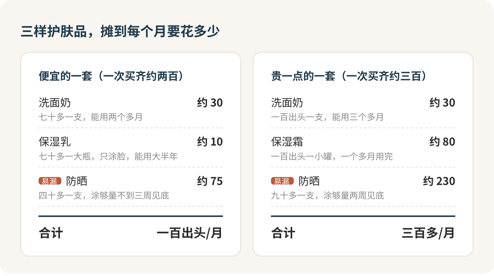

宿舍洗手台上要是摆了七八个瓶子，我敢说一半是白花的钱。日常护肤只要三样：一支温和的洗面奶，一瓶合适的保湿，一支每天涂够量的防晒。三样里真正值得花钱、花心思的只有防晒。精华、面膜、爽肤水、直播间里“一夜去闭口”的神水，多半是智商税，等这三样用顺了再说也不迟。

## 被柜姐一句话问住，很正常

第一次走进商场一楼的化妆品区，很多人心里是发怵的。柜姐上来就问“你是什么肤质”“平时用什么精华”，你答不上来，她就开始帮你“搭配一整套”，水、乳、精华、眼霜、面膜，一样一样往柜台上摆。直播间更狠，主播一句“这个价格只有今晚”，购物车就满了。

答不上来一点都不丢人。护肤被包装得这么复杂，是因为复杂才好卖货。你只要心里清楚自己就买三样，别的都可以客客气气挡回去：

> 我今天只看防晒，别的先不用介绍了，谢谢。

你是来花钱的，买什么你说了算，用不着看谁的脸色。

## 洗脸：少洗一次，比多搓一遍强

脸一油，第一反应往往是多洗几遍，再上磨砂膏来个“深层清洁”。这条路走反了。洗得越狠，皮肤越干越紧，有的人反而出油更凶、更容易冒痘。

我的做法很简单：早上不油就用清水，晚上用一次洗面奶，体育课出了一身汗再加一次，一天最多两次。洗面奶先在手心打出泡，用指腹轻轻带过全脸，别在鼻翼那里来回搓，冲干净后拿干净毛巾按干，别擦。

磨砂膏、撕拉鼻贴、电动洗脸刷，我的态度是别碰。鼻子上那些黑点是毛孔口堵住的油脂氧化变了色，跟脏没关系，搓不掉，越搓越红。

怎么知道一支洗面奶太猛？洗完紧绷到发疼、发红，就是它的问题。下一支换温和的，配方写着氨基酸、弱酸性的那一类就行，包装上“控油”“深层清洁”那几个大字可以不看。

## 保湿：一瓶就够，别叠五层

水、精华、乳、霜、面膜一层一层往上叠，在我看来是最典型的智商税组合。钱花了不说，叠得越多，脸出了状况越分不清是哪一瓶惹的祸。

一瓶保湿就够，按自己的脸挑：脸油的选清爽的乳液，脸干的选霜，额头鼻子油、两颊干的，选温和不刺激的那种。洗完脸、皮肤还有点潮的时候薄薄抹一层，十秒钟的事。

爽肤水、带酒精的“收敛水”可以直接省掉。对大多数人来说它们没什么用，有的还刺激皮肤。

## 防晒：这钱必须花，而且要涂够

如果这篇只能让你记住一件事，我希望是这句：防晒必做，而且你多半涂少了。

防晒有点像食堂饭卡。你以为充一次能吃一学期，正常打饭两周就见底；要是一学期过去还剩一大半，多半是每顿都没吃饱。一支防晒能用一整个夏天的人，基本都是每次只抹了薄薄一层。皮肤科医生给的量是一张脸至少一茶匙，差不多挤满食指加中指两根手指那么长。第一次照这个量挤出来，很多人会愣一下：这么多？对，就这么多。照这个量天天涂，一支六十毫升的防晒两周左右就见底。

买的时候看三样：SPF 30 以上，有 PA 标识，背面有一行“国妆特”开头的编号。防晒在国内要注册才能卖，这行编号就是它的身份证，找不到的别买。拿不准就直接问：

> 这款防晒的特殊化妆品注册证号是多少？

用法也就三句话：出门前十五分钟涂；在户外待着，两小时补一次；出了大汗或者游完泳，马上补。军训和体育课是最容易晒伤的时候，包里塞一支小的。

所以三样里我最舍得在防晒上花钱。预算紧，洗面奶和保湿往便宜里挑，省下来的钱全给防晒。

## 一个月到底花多少

按每天的正常用量摊开算，便宜的一套一个月一百出头，贵一点的三百多。差价的大头在防晒，因为它用得最快。

一瓶几百块的精华给你带来的变化，比不上一支天天涂够量的防晒。这是我最想劝你算的一笔账。

## “药妆”“医学护肤”，当广告词读

柜台和直播间最爱用“药妆”“医学级修护”“消炎祛痘”这些词。我的标签很简单：护肤品就是护肤品，它宣称自己能治病，本身就是违规的，国家药监部门明说过化妆品不许叫“药妆”“医学护肤品”。看到这几个字，直接当广告词读，价格里多出来的那一截，买的就是这几个字。

真正的药，药盒上印的是药品批准文号，怎么用归医生管。脸上真长痘了，别指望一瓶霜，去看[痘痘那一篇](jingzhi-09.md)。

## 刺痛不是在起效

“刺痛说明在起效，忍一忍就好”，这句话我一个字都不信。正常护肤不该疼。

涂完刺痛、发热、变红，当天就停掉最近新加的那一样，只留洗面奶和保湿。三五天好了，就是那一瓶不适合你，拍下名字和成分表，以后绕着走。要是越来越红、肿、痒，起小疹子，就去医院皮肤科，带上那瓶的照片，进门直接说：

> 我最近新加了这一瓶，用完脸发红发热，停了三天还没好，想请您看看是不是过敏。

加新东西我只守一条规矩：一次只加一样，先在下巴一小块试，用两三周再下结论。看到“立刻见效”“一夜焕肤”，先放下。

## 让它变成不用想的事

护肤坚持不下去，多半是步骤太多、要做的决定太多。那就把决定提前做掉：早上清水洗脸、保湿、防晒，三样放进同一个小篮子，伸手就拿到；晚上洗面奶加保湿，两分钟完事。哪天忘了也别懊恼，前面的不算白做，第二天接着来。

明天出门前，先把那支防晒挤够两根手指长。

## 参考

- [美国皮肤科学会：防晒霜怎么涂](https://www.aad.org/public/everyday-care/sun-protection/shade-clothing-sunscreen/how-to-apply-sunscreen)
- [美国皮肤科学会：长痘时的日常护肤习惯](https://www.aad.org/public/diseases/acne/skin-care/tips)
- [北京市药品监督管理局：特殊化妆品与普通化妆品怎么分辨](https://yjj.beijing.gov.cn/yjj/xxcx/kpxc/hzp36/743777602/index.html)
- [北京市药品监督管理局：化妆品监督管理常见问题解答](https://yjj.beijing.gov.cn/yjj/zwgk20/gg17/1694879/index.html)
- [化妆品监督管理条例](https://www.gov.cn/zhengce/content/2020-06/29/content_5522593.htm)
