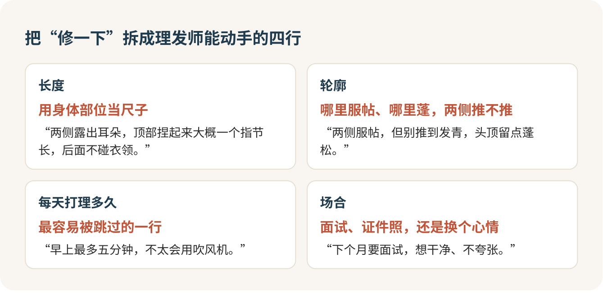

剪坏一次头，十次里有八次不怪理发师手艺，怪你给的信息太少。“修一下”“短一点”“您看着办”，就像点外卖在备注栏写“随便”，留多长、两侧推不推、每天愿不愿意吹头，全交给了一个刚认识你五分钟的人。剪完再解释已经晚了，多剪掉的两三厘米，要等两个月才长得回来。所以我的建议是：进店前花十分钟，把你要什么写下来。这比专门去找一个“总监”有用得多。

## 坐上椅子那一下最慌

围布一系，理发师站在你身后，从镜子里看着你问：“今天怎么剪？”很多人就是在这一刻脑子一片空白，嘴里只剩下一句“短一点就行”。怕说多了显得事多，怕说错了被笑外行，怕人家不耐烦，于是干脆把脑袋交出去，剪成什么样认什么样。

我想跟你说：说清楚是在帮理发师的忙。他最怕的就是“随便”，因为随便的意思是剪得不合心意全是他的错。你是来花钱的，提要求天经地义。好理发师最喜欢的，恰恰是那种坐下就能把话说明白的客人。

## 手机备忘录里写四行

现场组织语言太难了，那就提前写好。我会在手机里写四行，坐下直接递过去。

长度那一行，用身体部位当尺子：耳朵露不露，顶部捏起来有没有一个指节长，后面碰不碰衣领。“短一点”是没法执行的，“两侧露出耳朵”就可以。

轮廓那一行，说清哪里要服帖、哪里要蓬，两侧推不推，推的话推到多短。

第三行是每天肯花几分钟打理，这一行最容易被跳过，我却觉得它最要紧。你存的那些参考图，十有八九是吹过、抓过发蜡才拍的。你要是洗完头擦干就出门，必须让理发师知道，让他按“不打理也过得去”来剪。

最后一行写场合：下个月要面试，要拍证件照，还是单纯想换个心情。同样是短发，面试和换心情剪出来不一样。

## 带三张图，指着说要哪一块

光靠嘴说，你脑子里的样子和他脑子里的样子永远对不上，所以一定带图。只带一张正面图不够，两侧和后脑勺全靠猜，我会找同一个发型的正面、侧面、后面三张。手机里要是有一张自己以前剪得满意的照片，把它也带上，它比任何明星图都更接近你的发质。

递图的时候用手指着说，别只说“剪成这样”：

> 我要它两侧的短度和顶部的长度，不要它的颜色，也不要那个卷。

然后主动交代自己的短处：发量多还是少，头发软还是硬，有没有自然卷，发旋在哪，后脑勺是不是有点平。最后问一句：“按我的头发，能做到几成？哪里会跟图不一样？”让他先说哪里做不到，比剪完再争有用一百倍。

## 几个词听懂就够

理发店里的叫法没有统一标准，同一个词在两家店可能是两种剪法。背一堆名词没必要，听懂这几个就够用了。

渐变，是两侧和后面从很短慢慢过渡到较长，看不出分界线，起点越高，对比越强。收边，是只把鬓角和后颈边缘修短修齐，两侧大部分长度都留着，想要干净又不想太短的人，说“只收边”就对了。铲青，是两侧推得很短，跟顶部的长发不衔接，分界很明显，第一次剪短发的人慎选。打薄，是去掉发量，不一定改变长度，头发多、容易炸的人用得上，但打得太狠，长出来会翘。

还有推子的“几号”。每家推子的标法不一样，听到“两侧推个二号”，问一句“二号是几毫米”，心里就有数了。别不好意思问，这一句能救你一个月。

## 店怎么选：维持找快剪，换发型才去沙龙

理发店大致分几种：超市里的快剪，社区里的老理发店，分“设计师”“总监”的连锁店，还有商圈里的沙龙。

我的判断是：发型已经定了，只想把长出来的那截剪掉，快剪完全够用，十块钱，几分钟，这钱花得最值。社区店二三十块洗剪吹，手艺参差，碰上好的师傅能剪好几年。真想换一个新样子，再去贵一点的店，一两百甚至更多，多出来的钱，买的是他肯花时间听你说、肯动脑子替你设计。

至于头衔，“总监”“首席”“创意店长”都是店里自己封的，跟客流和价位挂钩，说明不了他合不合你意。为了两个字多付一倍，不值。肯听、肯解释的理发师才值钱。

## 开口有个顺序

坐下以后，我会按这个顺序说。先问价，免得最后被一句“洗吹另算”吓到：

> 我今天只剪发，不烫不染。剪发多少钱？洗和吹含不含？

再递备忘录和图，说完让他复述一遍打算怎么剪：顶部留多长，两侧剪到多短。复述对了再动剪刀。顺手补一句“先剪长一点，不够再短”，长了还能再剪，短了只能等。

推两侧之前喊一次停，看一眼再往上推：

> 先停一下，两侧推到这个长度我想看一眼，没问题再继续。

收尾前一定要看后脑勺。他拿镜子给你照的时候，别客气，后颈不齐、两边不一样长，当场说。

## 不舒服就说，别忍着

剪头发本身不疼，让人难受的都是小事：梳子扯到打结的头发，推子用久了发烫，后颈被刮得刺刺的，洗头水太烫，碎头发钻进领子里扎脖子。每一样都可以直接说，“这里有点扯，轻一点”“水有点烫”，一句话的事，用不着忍二十分钟。

不想一直聊天也完全没问题。他问你哪个学校、谈恋爱没有，你不想答，就说一句“我想闭眼歇会儿”。

头皮上有伤口、正在长痘的地方，坐下时先指给他，请他避开推子。

## 被推销、剪坏了，怎么收场

剪到一半，他说“你头皮有点油，做个护理吧”“要不要做个头皮检测”，先问价，不想要就一句话挡回去：

> 这个加项多少钱？不在刚才说的价里的话，我今天先不做。

办卡，我的态度是别办，第一次去的店尤其别办。剪一次觉得好，下次再来就是了，那张卡里预存的几百几千，是店里给你下的套。

真剪得不满意，当场说，而且说到部位。“不好看”没法改，“左边比右边长”“刘海比我说的短了，剩下的先别动”就能改。进门拍一张墙上的价目表，结账时对着付钱。

合适的理发师要试几次才找得到。找到了，就加他微信，下次进门直接说一句“跟上次一样”。

## 参考

- [QB HOUSE：怎样跟理发师沟通发型](https://www.qbhouse.com.hk/tc/process.php?wid=39)
- [工人日报（央视网）：如何才能让理发师好好理个发？](https://news.cctv.com/2025/01/03/ARTIS1xzhGooNnwFqLmR5yqr250103.shtml)
- [北京日报：节前美发迎高峰，平价理发店不涨价](https://xinwen.bjd.com.cn/content/s67943077e4b068c68f0ef7f8.html)
- [American Barber Institute：理发术语表](https://www.americanbarberinstitute.com/guides/barbering-glossary)
- [约翰斯·霍普金斯医学：头发正常生长与脱发](https://www.hopkinsmedicine.org/health/conditions-and-diseases/hair-loss)
