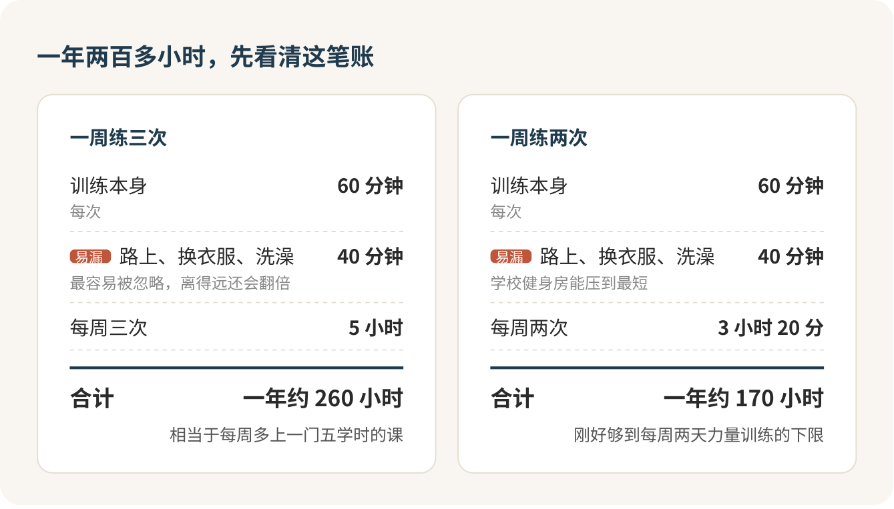

我去练，就是为了这几样：身材更健美，T 恤的肩线撑得起来，衣服穿着更好看；身上有了力气，人也跟着有底气。健身不会让你立刻有女朋友，别带着这个指望走进健身房，不然三个月后你会同时失去耐心和那张卡里的钱。它真正的价钱也不在会员卡上，在时间和精力：一周练三次，一年就是两百多个小时。

## 先算时间，再看会员卡

我拿最常见的安排来算：一周三次，每次练一个小时，加上来回路上、换衣服、洗澡四十分钟，一次就是一小时四十分钟。一年下来，两百六十个小时左右。

这相当于你每周多选了一门五学时的课，没有期末，没有学分，缺勤几周，前面攒下的进度就开始往回退。办卡之前你得先问自己：这门课，我真的选得起吗？

那四十分钟的路程是最能省的。健身房就在宿舍楼旁边，单程十分钟；要坐车去商场里的店，一趟可能多出一个小时。所以我给选场馆贴的标签是：离得近，比装修好重要十倍。太远的健身房，你会越来越找得到理由不去。

接受不了两百多小时，就从一周两次开始，一年一百七十来个小时。两次一点不寒碜，它刚好够到国家运动指南给成年人的力量训练下限：每周至少两天。

见效的速度你也做不了主。动作标准、重量慢慢加、每周不缺勤，这些你管得了；骨架、遗传、多久能在镜子里看出变化，管不了。练个两三个月看不出啥，很正常，别急着怀疑人生。

至于脱单，状态好了，出门社交确实更有劲，可别人喜不喜欢你，远不止身材这一样。把它当成顺带的好处，别当目标。

## 先在学校练满一学期

钱的事反而简单。很多学校的健身房对本校学生免费或者很便宜，刷校园卡就能进。我的建议很明确：学校有健身房，先在那里练满一个学期，确认那两百多个小时你真的付得起，再去外面花钱。

外面的商业健身房，月卡大多一两百到四五百，年卡一两千起。按月买和按年买，一年下来能差个七八百块，听着很诱人，但前提是你一整年都去。年卡摊下来“一天才四块多”，这话最会骗人，那张卡逼不了你去，路程和课表才决定你去不去。

团课是另一种路子，按次付钱，六七十块一节，跳操、单车、拳击，有人带着练，适合一个人坚持不下来的。

## 前台那十分钟，比器械可怕

第一次去健身房，最让人发怵的往往不是不会用器械，是前台那十分钟：会籍顾问热情地领你参观一圈，然后请你坐下“了解一下今天的优惠”。“今天办才有这个价”“名额只剩两个”，话术一套一套的，你脸皮薄，不好意思拒绝。

我给这一关定的规矩：第一次只买单次或体验，年卡和私教一律带回去想。你不用解释，也不用觉得欠了谁的人情，把它当成双十一的倒计时：先加购物车，回去比完价再说。

> 我今天先体验一次。麻烦把价格表、退费办法和合同给我拍一下，我回去对比完再决定。

真要填资料，健康状况照实写，旧伤、哮喘、心脏的毛病都写上。有慢性病的，先问过医生再来练。

## 私教：买几节学动作，大课包别碰

私教一节两三百，课包常常十几节起卖，一下就是三四千。销售最爱说“买得越多越便宜”，我给大课包贴的标签是：别碰。

我的建议是只买够学会基础动作的几节，学会怎么调座椅、怎么发力、哪些动作容易做错，然后自己练。有一件事很多人不知道：在北京，健身行业的预付费示范合同里明确写着私教课不适用这份合同，私教怎么退，全看你签的那份私教合同。所以签之前，让对方在纸上写清楚总节数、总价、每节单价、有效期、没上完按什么价退。只有口头承诺的，别签。

> 我只想先买几节学基础动作，不买大课包。中途不想上了，剩下的课按什么单价退？能写进合同吗？

## 第一次进器械区，就做这几件事

包里带上运动鞋、毛巾、水杯和换洗衣服。第一次去连参观带练，留一个半小时比较从容。

进去以后，先在跑步机上快走或者骑单车五到十分钟热身。然后找工作人员或驻场教练，请他教你三四台固定器械，比如腿举、坐姿推胸、高位下拉、坐姿划船，问清座椅怎么调、哪里不能锁死。

> 我第一次来，想学这几台器械怎么调、怎么发力，能帮我看一下动作吗？

每台挑一个能轻松做完、动作不变形的重量，做两三组就停。第一次练到力竭，这件事我直接说：别这么干。新手最容易犯的错，就是第一天想把这几年欠的都补上。

走之前拉伸几分钟，用手机备忘录记一笔：哪个动作、多重、几次几组、感觉怎么样。下次在轻松的项目上加一点点，这就是进步。

## 第二天腿软，不算成绩

第一次练完腿，第二天下楼梯扶着栏杆走，太正常了，那是延迟性肌肉酸痛，一般训练后一到三天出现，几天就消。酸不代表练得好，不酸也不代表白练。这几天照常生活，酸的部位先别再练狠的，可以换练上半身，或者散散步。

> 我昨天第一次练腿，今天下楼梯很酸，是休息，还是换练上半身？

有两条底线，必须记住。训练中胸口疼、头晕、喘不上气、关节突然剧痛，立刻停下，找工作人员。练完以后肌肉疼得比想象中重得多、浑身没劲、尿像浓茶或者可乐的颜色，马上去医院，这可能是横纹肌溶解，一刻都别拖。第一次就拼命练到力竭的人，最该记住这一条。

## 签字之前，留一手

真要办卡了，记住几条北京的规矩（别的城市看当地规定）：买了预付卡七天内还没开始用，可以要求全额退；“概不退款、解释权归商家所有”这种条款是无效的；店家要停业搬迁得提前公告，你可以要求退还没用完的钱。

规矩是规矩，最稳的还是少预付。先按次、按月练一两个月，确认自己真的每周都去，再谈季卡年卡。

这周就去一趟学校健身房，带上校园卡和一双运动鞋，先把门推开。这个学期练满了，下学期要不要花钱，你心里自然有数。

## 参考

- [中国人群身体活动指南（2021）](https://html.rhhz.net/zhlxbx/20220102.htm)
- [世界卫生组织：身体活动](https://www.who.int/news-room/fact-sheets/detail/physical-activity)
- [北京市体育健身行业预付费服务合同（2022）](https://scjgj.beijing.gov.cn/bsfw/bmfw/sfwbbm/shxfl/yfk/202204/t20220421_2684551.html)
- [北京市单用途预付卡管理条例](https://www.beijing.gov.cn/zhengce/dfxfg/202111/t20211130_2549001.html)
- [克利夫兰医学中心：延迟性肌肉酸痛](https://my.clevelandclinic.org/health/diseases/delayed-onset-muscle-soreness)
- [美国疾控中心：横纹肌溶解的症状](https://www.cdc.gov/niosh/rhabdo/signs-symptoms/index.html)
