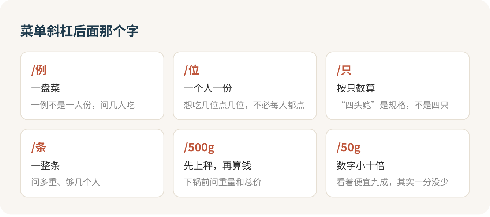

在高档中餐厅，会点菜的人才是这桌的主心骨，酒量排第二。一桌饭的体面和账单，都是点菜那几分钟定下来的，而点菜最要命的一件事，是看清菜价后面那道斜杠。

## 斜杠后面那个字，比数字重要

第一次翻高档中餐的菜单，很多人会被一种奇怪的感觉困住：每个数字都认识，合起来却算不出这顿多少钱。

问题出在斜杠。同一本菜单上，“/例”是一盘，“/位”是一个人一份，“/只”按只数，“/条”是一整条，“/500g”是先上秤再算钱。这有点像食堂：麻辣香锅按克称，盖饭按份卖，你从来不会拿两个窗口的价签直接比。到了高档中餐厅，这些窗口挤进了同一本菜单，没人替你分开。

最坑人的是按重量卖的海鲜。有的菜单写“每 500 克”，有的写“每 50 克”，数字一下小了十倍，第一眼像是便宜了九成，其实一分没少。所以海鲜我只认一个动作：先问重量和总价，再点头。

> 这条鱼多重？按菜单单价，加上服务费大概多少？

嫌大就接着问：“有没有小一点的？我们四个人，一斤出头就够了。”

拿北京王府井文华东方的中餐厅举个例子，老虎斑 568 元一斤，一条一斤二两的鱼，乘完 15% 服务费就快八百了。鱼要是称出来重了二两，账单上就多出一百多。这不是谁在坑你，按秤卖的东西本来就这样，你只要在下锅前把这句话问出口。

菜单只写“时价”的，更要问。现在的规矩是不同规格要分别标价，不许拿“时令价”糊弄人，你问“今天多少钱、按斤还是按条”，是天经地义。

## 茶是一桌饭里最容易漏算的大头

这一条我想单独拿出来说，因为几乎每个第一次请客的人都会栽在这里。

高档中餐厅的菜单上未必有“茶位费”三个字，但茶常常是按位收的。一位一百多的功夫茶，四个人喝，再乘服务费，将近六百。照着那家的菜单配一桌四个人的饭：一条鱼、每人一只鲍鱼、三道蔬菜、四位茶，加完服务费人均七百出头，茶排在鲍鱼和鱼后面，是全桌第三贵的一项。

所以订座时，把茶和包间一起问掉：

> 茶是按人收吗？不点茶的话，可以只要白开水吗？

不想喝茶就要白开水，一点不寒碜。真想喝，挑一款大家都能喝的，按实际人数点。

## 最低消费是违法的，包间费要先说

“包间最低消费三千”这种话，你可以直接不认。2025 年施行的《餐饮业促进和经营管理办法》里有一句很干脆的话：禁止餐饮服务经营者设置最低消费。

包间费是另一回事，它可以收，但必须事先告诉你。所以订包间我一定问一句“有没有包间费、几位起订，大厅和包间的服务费一样吗”，再要一条文字确认。

人多、有长辈、要谈事情，包间值。两三个人吃饭，我选大厅，少一层费用，少一轮沟通，菜是同一个厨房出来的。

## 点菜的人怎么开口

点菜不靠背菜名，靠三句话：人数、预算、忌口。

> 我们四个人，预算含服务费两千五左右，有一位不吃辣。请按这个帮我们配一桌，够吃就行。

看不准份量，就问“这道一例大概几个人吃”。

现在的规定要求店家不能诱导你超量点餐，点多了还得提醒你。所以请服务员按人数配菜，是理直气壮的请求，不是露怯。

我的点法是先定一道主角，一条鱼、一道鲍参或者一只烤鸭，再配冷菜、热菜、蔬菜和主食。按位计价的菜，按想吃的人数点，不用每人一份。点完请服务员复述一遍。

当着客人问价，很多人怕显得小气，这个顾虑我懂。办法有两个：订座时就把预算说清，让服务员心里有数；或者去洗手间的路上，顺道到前台问一句。被推荐当日海鲜，先问单位和重量，不合适就说“谢谢推荐，今天菜够了”。

## 请客和被请，位置不同

你请客，你主导点菜，或者让服务员推荐、你来拍板。客人问你“随便点吧”，别真的随便，问一句“有没有不吃的”，然后照着人数和预算来。

你被请，主人问忌口就照实说，过敏就说“过敏”。别抢着点贵的，也别客气到什么都说“都行”，主人最怕的是你吃不好。

至于酒，我的态度很明确：喝不了就不喝，说一句“我今天不喝酒，以茶代酒”就够了。一桌人记住你，是因为你把菜点得妥帖、把账算得清楚，跟你喝了几杯没关系。

## 吃饭和散场

要公筷就直接说“麻烦加几双公筷”，这是店家应该准备的东西。宴请型的中餐，一桌坐两三个小时很常见，时间要留够。

吃不完就打包，大大方方。按人数点、吃不完打包，就碰不到那一项“厨余垃圾处理费”。

结账时拿明细逐行看：按重量的菜，克数和单价对不对；茶是不是按实际人数收；服务费几个点、基数对不对；有没有事先没告诉你的包间费、餐具费。

> 麻烦给我看一下明细。这条鱼是多少克？服务费是按 15% 算的吗？

第一次替一桌人点菜，手心冒汗很正常。记住你手里那三句话，再记住一个动作：鱼下锅之前，先问那一句“多少克”。

## 参考

- [Café Zi｜北京王府井文华东方酒店](https://www.mandarinoriental.com/en/beijing/wangfujing/dine/cafe-zi)
- [商务部《餐饮业促进和经营管理办法》](https://www.mofcom.gov.cn/zfxxgk/zc/gz/art/2025/art_8f2a2ccb933b46bba6ba30d7efbf8e8a.html)
- [京津冀三地市场监管部门 2026 年春节消费提示](https://scjgj.beijing.gov.cn/zwxx/scjgdt/202602/t20260206_4495291.html)
- [北京市《餐饮等五个行业明码标价试行规定》](https://fgw.beijing.gov.cn/fgwzwgk/2024zcwj/bwqtwj/201912/t20191226_3719658.htm)
- [部分餐馆“最低消费”以新名目悄然回归（新华网）](https://www.news.cn/fortune/20260528/79487c4de3984909aa5fd3c9dc043412/c.html)
