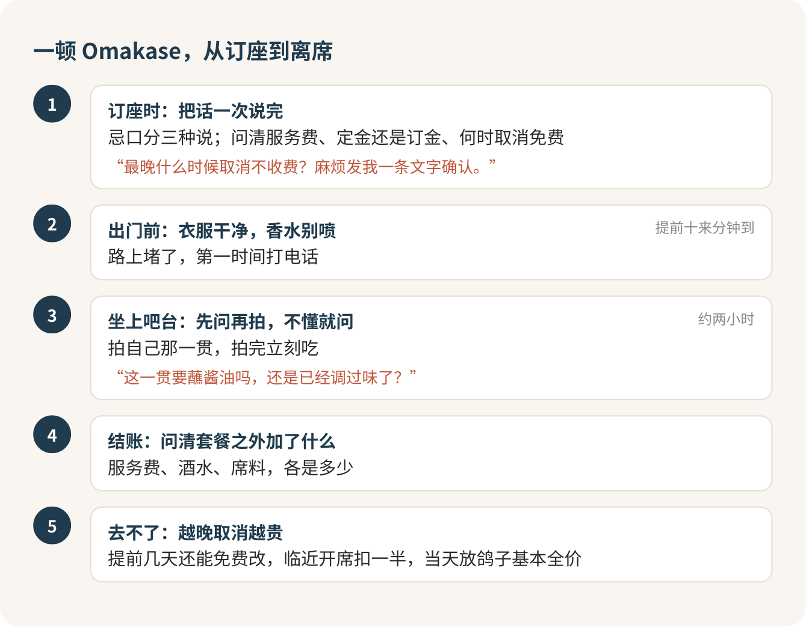

Omakase 值得吃一次，前提是你真的愿意把选择权交出去。这顿饭的规矩几乎全在订座那一步：忌口、定金、迟到、取消，坐下之前说清楚；真坐到师傅面前，你要做的只剩两件事，吃，和问。

## 它到底是什么

おまかせ，日语里是“交给你了”。没有菜单，师傅按当天的鱼决定给你吃什么，在你面前一贯一贯地捏，捏好一贯递一贯，你跟着吃。

很多人第一次坐上吧台，紧张的不是吃，是“被看着”。八九个座位一字排开，师傅就站在一臂之外，好像你每一个动作都在被打分。没有人在给你打分。师傅每天面对的都是第一次来的客人，他关心的是这一贯你吃得开不开心，不是你筷子拿得标不标准。

## 先算钱：这是一顿要提前存钱的饭

北京像样的 Omakase，人均一千上下是常态，名气大的店两千左右，酒水另算。两个人去，先按四千准备，不会错。

这么贵，值不值？我的判断是：生鱼、贝类、鱼卵你都爱吃，又对“今天吃什么由别人决定”这件事不抵触，值，一辈子至少该吃一次。要是你不吃生的、贝类过敏、海胆鱼卵一口都不碰，别去，你付的是一整套的钱，能吃到的只有一半。

第一次去，我选午市。同一个师傅、同一块吧台，午市往往比晚市便宜一大截，有的店差出将近一半，节奏也短一点。先拿午市试试自己是不是吃这一口，喜欢了，再去晚市。

## 订座时，把话一次说完

Omakase 的菜是师傅提前备好的，你坐下再说“我不吃这个”，已经晚了。忌口分三种说，师傅最好安排：

> 我对虾蟹过敏，汤底里有也不行。我不太吃海胆和鱼卵，其他都可以。生鱼没问题，生的贝类不太习惯，能换成熟的吗？

过敏是安全问题，不吃是口味问题，生熟是习惯问题，分开讲，师傅一听就知道哪条是红线。限制太多的人，有的店会直接说订不了，别往心里去，他是真做不出一套给你。

钱的事也在这一步问完，别不好意思：

> 套餐每位多少？含不含服务费？订座要付钱吗，最晚什么时候取消不收费？

这里有个小知识值得记住：“定金”违约是不退的，“订金”可以商量着退。付钱之前听清楚是哪个字，最好要一条文字确认。

## 别迟到，也别临时放鸽子

这一条我说得重一点，因为它最贵。

Omakase 的座位少、场次死，一晚两场，前一场散了后一场马上开。你迟到，错过的菜不会补；迟到太久，有的店直接不上菜，钱照收。空一个座，后面排队的人也补不进来。这就像抢到一门只有八个名额的研讨课，选上了就得按时到，临时退课，谁也替不了你。

所以我的原则只有一条：确定能去才订。很多店订座要绑卡或预付，越临近开席取消扣得越多，提前几天还能免费改，当天放鸽子基本是全价。路上堵了，第一时间打电话：

> 不好意思，路上堵车，大概晚十分钟到，先跟您说一声。

出门前两件小事：衣服干净、别太随便就行；香水少喷，最好不喷。吧台离鱼、离邻座都太近，你的香水会盖住别人那一贯的味道。

## 坐上吧台：不懂就问，问了就是会吃

进门报名字和场次，店员带你入座。拍照先问一句，常见的规矩是能拍菜、不能录像，拍自己那一贯就好，别拍到师傅和别的客人的脸。拍完立刻吃，寿司是捏好就该入口的东西，多放一分钟，饭的温度就过了。

吃法完全不用背。“这一贯要蘸酱油吗，还是已经调过味了？”“我第一次吃，能不能每一贯说一下是什么鱼？”“我吃得慢，您稍等我一下。”这三句话够你从头吃到尾。

问“这是什么鱼”永远不失礼，很多师傅就喜欢边捏边聊。想安静吃也没问题，点头、吃、说一句“好吃”，他就懂了。吃到一半饱了，可以请师傅把饭捏小一点。

酒水默认另算，除非套餐写明含酒。不喝就直说“我今天不喝酒，有茶吗”，没人会多看你一眼。结账时问清套餐之外加了什么：服务费、酒水、有的店还有一点席料费。

## 它真正的代价

Omakase 有一笔不写在账单上的代价：你得把选择权交出去，在别人眼皮底下老老实实坐两个小时。喜欢自在、喜欢挑菜、喜欢边吃边刷手机的人，会觉得这顿饭憋得慌。这没什么不好意思的，说明它不是你的菜，省下的钱换一顿痛快的烤肉，一样是好日子。

要是你决定去了，那就放松坐下，把今晚交给师傅。付定金之前，先把“最晚什么时候取消不收费”这句话要成文字。

## 参考

- [日本 OMAKASE 和回转寿司风靡中国（日经中文网）](https://cn.nikkei.com/china/ceconomy/52476-2023-06-05-05-00-37.html)
- [广州滩万晚餐菜单（滩万官网）](https://www.nadaman.co.jp/pages/restaurant_guangzhou_menu_dinner-menu)
- [Sushi Shikon 订座页与用餐须知（香港）](https://www.tablecheck.com/en/shops/sushi-shikon/reserve)
- [京津冀三地市场监管部门 2026 年春节消费提示（定金与订金）](https://scjgj.beijing.gov.cn/zwxx/scjgdt/202602/t20260206_4495291.html)
