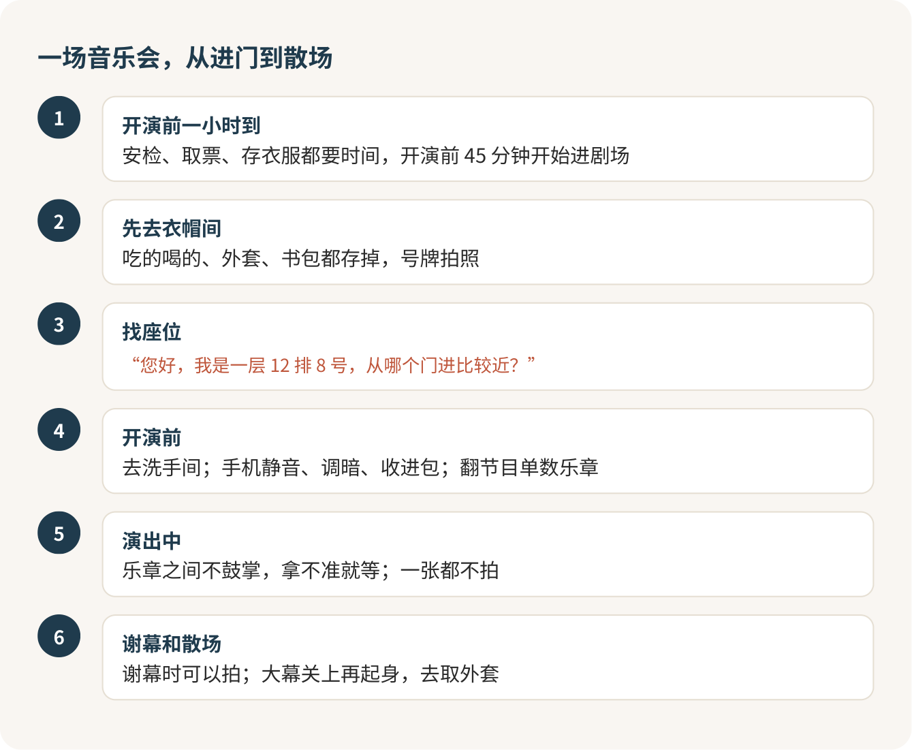

第一次进剧场，穿什么最不用操心。真正会让你难受的只有三件事：迟到被关在门外，在乐章之间一个人鼓了掌，演出中举起手机拍照。守住这三条，剩下的都是小事，你完全可以放松坐着享受这一晚。

我知道第一次去的那种紧张：大厅金碧辉煌，周围的人看起来都很懂行，你怕自己哪个动作露怯，怕鼓错掌全场回头看你。其实剧场里大多数人也没那么懂，他们只是比你早知道这几条规矩。今天我都告诉你。

## 先想好，再下单：票基本退不了

这条放在最前面，因为它最伤钱。剧场的演出票，绝大多数售出后不退不换，因个人原因去不了，只能自己想办法。有的场次会开一个短短的免费退票窗口，写在开票公告和购票页里，下单前截个图。除此之外，别指望退。

所以买票之前，把那天的课、考试、社团活动都想一遍。还有一条硬规矩：从黄牛、二手群这种非正式渠道买的票，出了问题剧院不管。大剧院这类剧场是实名购票、实名入场的，别人名下的票你多半进不去。别贪便宜。

## 贵的座位，不一定看得清

价格高低和看得清楚并不完全对应。有的剧场商品页会专门列一段“遮挡提示”：乐池前排、一楼前几排两侧可能被台口装置挡住，控台旁边的座位会被屏幕光晃，二楼前排有安全栏杆。页面还会写一句，买了这些位置就视为知情，不能以此为由退换。

所以我的选座顺序是：先打开座位图，把页面列出的遮挡区全部划掉，再按预算挑。

音乐会和戏剧要分开看。听音乐会，看不清钢琴家的手指影响不大，坐远一点、偏一点都行，买最便宜那档完全够用，这钱省得值。看音乐剧和话剧，要看演员的表情和走位，侧面太偏会很吃亏，宁可往后坐，也别往两边偏。

## 学生票，一定要先找

这是我最想推荐的一件事。国家大剧院有面向学生的“圆梦计划”，通过学校团委这类渠道组织，常见的是一两百块一张，比正价便宜一大截。名额有限，进门要带学生证和身份证原件，票不能转让。先去问问自己学校的团委或者艺术团有没有对接，这是学生身份最划算的用法。大剧院官网购票页上也有“学生票购买”的入口，哪场开放就看哪场。

正价票的话，大剧院一场音乐会最便宜的一档通常两三百块。第一次去，买最便宜的就够了。

## 迟到：像期末考开考后进不了场

迟到几分钟、猫着腰溜进去，在剧场里行不通。

规矩是这样的：迟到的人在门外等候区安静等着，到曲目之间或者幕间，由工作人员带着轻声进去，就近坐下，等中场休息再回到自己的座位。如果整个下半场只演一首曲子，比如一部完整的交响曲，那迟到三分钟，就意味着整个下半场在门外听。

这跟期末考一模一样：开考后过了时间就不让进，迟到三分钟和三十分钟，在门外的结果是一样的。

真迟到了，别慌，也别硬闯，找门口的工作人员说一句：

> 不好意思，我迟到了，下一个能进场的间隙是什么时候？

然后安安静静在外面等，没人会怪你。

所以一定要早到。大剧院这类剧场一般演出前 45 分钟开始进剧场，我会按这个时间倒推出门，再多留 20 分钟给安检、取票和存衣服。去国家大剧院还有一个小细节：那颗“蛋”四面是水，观众只能走北门。坐地铁 1 号线到天安门西站，C 口出来就是北门入口，别绕着湖找门。

## 进去之前：先去衣帽间

剧场里不让带吃的、喝的、瓶装水、鲜花和大件行李。在大剧院，这些可以免费存在衣帽间，离场时取回。外套、保温杯、书包都交出去，只带一个能放在腿上的小包。号牌拍张照存在手机里，丢了还得挂失交钱。

找不到座位，别自己在黑暗里摸，直接问门口的引座员：

> 您好，我是一层 12 排 8 号，从哪个门进比较近？

开演前去一趟洗手间，把水喝够。这两件小事比任何礼仪都重要，因为一旦中途出去，就得等下一个曲间或幕间才能回来。

## 什么时候鼓掌：拿不准就等

音乐一停就鼓掌，这是第一次去的人最容易犯的错。一部交响曲通常有三四个乐章，乐章之间会安静几秒，那几秒不鼓掌。

拿不准的时候，我的办法就一个字：等。等台上的指挥或者独奏者把手放下、转过身面对观众；或者等大多数人先拍，你再跟上。晚两秒鼓掌永远不会出错，早两秒才会。

开演前翻一下节目单，看看每首曲子有几个乐章，心里数着，就知道要等几次安静。音乐剧和话剧没这么讲究，精彩的唱段结束大家自然会鼓掌，跟着现场多数人走就行。

## 拍照：演出中一张都别拍

“不开闪光灯，拍一张没关系”，这句话在剧场里不成立。演出期间不拍照、不录音、不录像，手机调静音，屏幕亮度调到最低，收进包里。你举起手机那一下，黑暗里亮起的屏幕整排人都看得见，后面的人会很烦，工作人员也会过来提醒。

能拍的时间是谢幕。演员出来谢幕的那几分钟，通常是可以拍的。进场前、中场休息时，在公共区域拍拍建筑也可以，除非看到禁拍标志。

## 穿什么：整洁就行，带件外套

穿西装、晚礼服？完全不用。大剧院的硬性要求只有“着装整洁”，正式一点的服装只是建议。干净的衬衫或针织衫，长裤或裙子，就够了。拖鞋、背心、运动短裤留在宿舍。

比纠结穿什么更实际的是温度。剧场里一坐两三个小时，空调可能偏凉，带一件薄外套比穿什么都有用。

## 中途想走，散场别挤

中途身体不舒服，可以轻声离开，示意工作人员帮忙就行。只是要知道，出去以后就得等下一个间隙才能回来，有的曲目根本不给你回来的机会。

演出结束，等演员谢幕完毕、大幕关上再起身，别在谢幕时站起来往外挤。谢幕那几分钟，正好拿出手机拍一张，留个纪念。然后去衣帽间，号牌就在你相册里。

出门前再过一遍：票在手机里，身份证在包里，开演前一小时到，乐章之间先别拍手。做到这几样，你就是那晚剧场里最普通、也最合格的一位观众。

## 参考

- [国家大剧院观演礼仪](https://www.chncpa.org/gywm0118/bzzx/gkyc_398/202203/t20220314_241190.shtml)
- [国家大剧院购票及观演须知](https://www.chncpa.org/gywm0118/bzzx/gkyc_398/202203/t20220314_241196.shtml)
- [国家大剧院文明观演须知](https://www.chncpa.org/zxdtxlm/jyxw_2994/202507/t20250724_277706.shtml)
- [国家大剧院参观购票与参观须知](https://www.chncpa.org/cgyl_278/cggp/)
- [国家大剧院官网购票页（含学生票入口）](https://wticket.chncpa.org/product.html?id=10002817)
