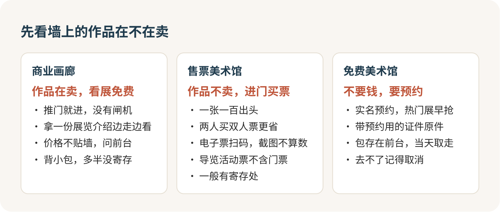

看不懂作品，一点也不妨碍你进去。去之前只需要分清一件事：墙上的作品在不在卖。在卖的是画廊，推门就进，不要钱，不买也没人赶你；不卖的是美术馆，进门要买票，或者要提前预约。分清这一点，剩下的都好办。

很多人第一次站在画廊门口会犹豫：玻璃门、白墙、前台坐着一个打扮得很精致的人，里面安静得能听见自己的脚步声。你会想，我一个学生，又不买画，进去是不是很尴尬？会不会被人一眼看穿“他看不懂”？

我想告诉你：画廊欢迎你。看展的人越多，画廊越高兴。你不需要装作懂，也不需要装作要买。

## 三种地方，三种门槛

商业画廊，比如 798 里的常青画廊，作品是要卖给收藏家的，但看展完全免费，门口只有一张前台桌，没有闸机，推门就进。

售票美术馆，比如同在 798 的 UCCA 尤伦斯当代艺术中心，作品不卖，进门要买票，一张一百出头，两个人买双人票更划算。

免费美术馆，比如五四大街上的中国美术馆，不要钱，但要提前实名预约，周一闭馆。

## 画廊：推门就进，看完道谢就走

进门对前台点个头就行。想多知道一点，可以说：

> 您好，我随便看看，可以拿一份展览介绍吗？

很多画廊前台放着展览文字或作品清单，拿一份边走边看，比在墙上找小字轻松很多。这份纸就是最好的导览。

作品价格多半不贴在墙上。你对哪件作品好奇，问年份、问材料、问作者，前台通常很乐意回答：

> 这件作品是哪一年的？有作品清单可以看一下吗？

问价格也可以，只是心里要有个准备：画廊的报价是给收藏家的，跟你的生活费不在一个世界里。听到数字别惊讶，点点头就好。

看完往门口走，说声“谢谢”，不用任何别的交代。不花一分钱走出画廊，是画廊里最平常的一种访客。

## 美术馆：钱，或者时间

售票美术馆的门槛是钱。买票前看清楚票种：双人票两人分下来，比各买一张便宜不少；优待票是给谁的，在购票页里看说明，或者到前台问一句“学生证能买优待票吗”。很多售票是电子票，进门要打开票夹扫码，截图不算数。

年卡、会员值不值？我的标准很简单：一年确定能来三次以上，就值；否则就是一张躺在抽屉里的卡。第一次去，买单次票就好。

免费美术馆的门槛是时间。中国美术馆每天限人数，提前七天放号，热门展得早点抢。预约了去不了，记得当天取消，爽约几次会被暂停预约。到馆带上预约时用的那张证件原件。

还有一个坑：别把导览票当成门票。有的美术馆会卖十块钱的“特邀导览”活动票，写得清清楚楚“不含展览门票”，进展厅还得另买票。十块钱导览不等于十块钱看展，下单前看一眼。

## 看不懂？那就只看三件

不懂是常态。策展人写前言，就是为了让你看懂一部分。看展跟上一门陌生的选修课差不多：你不需要听懂每一页 PPT，能记住一页、带走一个问题，这节课就没白上。

我的办法很简单，三步：

先读入口处的展览前言，一两分钟，知道这次展览想聊什么。

然后别急着每件都看。走一圈，挑三件让你停下脚步的作品，不管是因为好看、奇怪，还是让你不舒服。读旁边的展签，作者、年份、材料，在它前面多站一会儿。

最后问自己：它让我想到了什么？

看完一个展，只记住一件作品，也算没白来。这比拍了两百张照片、一件都想不起来强得多。

有些当代美术馆里的作品是能参与的，可以走进去、坐上去，甚至躺下来。哪些能碰、能坐，听现场工作人员的，别自己猜。

## 拍照、说话和那个大包

拍照，进门先看墙上和展签旁边有没有禁拍标识，没有就问前台“展厅里可以拍照吗”。能拍的时候，三条底线：不开闪光灯，不挡别人，不为了取景往后退撞到作品。自拍杆、稳定器、三脚架，中国美术馆明确禁止，其他地方也别带。

摸作品，任何时候都不行。手指想指点画面，离作品远一点。

和朋友一起看，聊天是最好玩的部分，也是最容易惹人烦的部分。音量只让身边那个人听见；站在作品前讨论，往后退半步，给后来的人留出视线。

包尽量小。中国美术馆要求随身包裹存在展厅前台，下午五点前取走。美术馆一般有寄存处，画廊空间小，多半没有，背个小包最省事。

## 一个人去，最自在

一个人看展特别好。没人催你，可以在喜欢的作品前站十分钟，也可以十分钟逛完一个展厅就去喝咖啡。站久了脚会累，这是看展最实在的负担，有长椅就坐，展厅外有咖啡厅就歇一会儿。中国美术馆这样的大馆，按一个半到两个小时安排比较从容。

周末想去 798，我会这样排：先逛一家免费画廊热热身，再去一家售票美术馆看一个大展，中间在园区里喝杯咖啡。一下午，人均一百块左右，这钱花得值。

推门进去，拿一份展览介绍，找到那一件让你停下来的作品，然后走出来，跟前台说声谢谢。就这么简单。

## 参考

- [常青画廊北京空间当前展览](https://www.galleriacontinua.com/exhibitions-list/current/beijing)
- [UCCA 尤伦斯当代艺术中心](https://ucca.org.cn/exhibition/carsten-holler/)
- [中国美术馆预约须知](https://www.namoc.cn/namoc/cgzn/202507/a737a2697fed43f9a68637767dc0c54e.shtml)
- [中国美术馆文明参观须知](https://www.namoc.cn/namoc/cgzn/202507/51004d6f2fef4159b246b545c9c52626.shtml)
- [中国美术馆官网](https://www.namoc.cn/)
