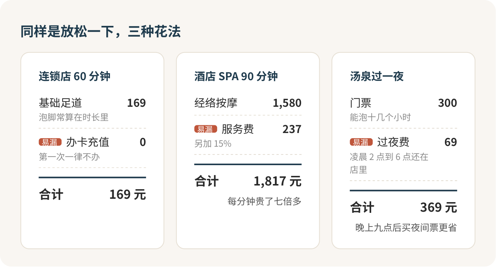

按摩、搓澡、汗蒸，第一次去只要记住一句话：不舒服就喊停。钱是你付的，躺在床上的是你自己的身体。疼了、尴尬了、不想被碰哪儿了，当场说出来，天经地义，不用道歉，也不用解释。

## 心里发怵，太正常了

第一次去按摩店或者洗浴中心，紧张的多半不是钱，是一串说不出口的问题：要不要脱衣服，内裤脱不脱，技师是男是女，按疼了能不能说，说了会不会显得自己很娇气，结账时会不会冒出一串看不懂的项目。洗浴更难，要在一屋子陌生人面前光着身子走来走去，很多人就卡在更衣室门口那一下。

这些问题前台每天都要回答很多遍，你不是第一个问的，也不会是最后一个。问出口，比憋着装老手体面得多。

## 第一次就去连锁店，按六十分钟

先说钱。第一次想知道被按是什么感觉，去口碑正常的连锁店做一个六十分钟的基础项目，足道或者肩颈背，一百六七十块。酒店 SPA 先别碰：一个九十分钟的经络按摩一千五六，再加百分之十五的服务费，奔着一千八去了。

算到每分钟，酒店贵了七倍多。差出来的是装修、桑拿房、精油和那一整套仪式感，手法本身差不了这么多。等你确定自己喜欢被按，再专门存一笔钱去享受那套仪式，那时候它才值。

城市里那种汤泉洗浴，一张门票三百上下，能泡十几个小时，汤池、汗蒸、浴服拖鞋、水果饮品都在里面。按这个价看，它是几样里最划算的放松，前提是别被后面那些加项拖着走。

## 约之前，先过一遍自己

按摩对健康的人很安全，但有几种情况，我的态度就一个字：别去。喝了酒、刚吃撑、饿着肚子，不按；发烧、有没好的伤口、皮肤破了起了疹子，不按；怀孕或者经期，肚子别让人碰。心脏有毛病、血压控制不好的，汗蒸房和热池也别进。

腰扭了、落枕了、打球拉伤了，想“按一按就好”？别。去医院骨科、康复科或者中医推拿科。保健店的技师能帮你放松，替你诊断不是他的活，急性的伤按错了只会更重。

## 下单时把话问在前头

不管去哪家，打电话或者在平台下单时，把这几句问完：

> 这个六十分钟是纯按的时间，还是包括泡脚、换衣服？

> 可以指定女技师（或者男技师）吗？

> 价格含服务费吗？精油、加项要另外收钱吗？

第一句最要紧。足道常把泡脚算进时长；酒店 SPA 迟到了不顺延，取消晚了还要全额照收。问清楚，你才知道这钱买了几分钟真按。前台说不清价格、只会说“先进来再说”的店，直接换一家，这种店别进。

## 换衣服那一下最尴尬

按摩前通常要换衣服，这是第一次最慌的环节。规矩其实很简单：你换衣服时技师会出去，按的时候身上盖着一条大毛巾或者床单，按哪块才掀开哪块。有的店给一次性内裤或者按摩服，做足疗只要把裤腿卷起来。拿不准就问：

> 需要换衣服吗？内衣要脱吗？

不想脱，就说不想脱，对方会配合你。开始前把范围说死，比如“只按肩颈和背”。项目里带臀部、腹部这些部位的，你有权说不。任何让你不舒服的触碰，当场叫停，不需要任何理由。

## 按的时候，就像跟理发师说“再短一点”

技师的手跟理发师的推子差不多，你不吭声，他就按自己的默认来。你在理发店敢说“两边再短一点”，躺在按摩床上说“这里轻一点”是一样平常的事。“越疼越有效”这话是骗人的。酸胀可以忍，刺痛、发麻、头晕、心慌，马上停。

> 这里太重了，轻一点。停一下，这个位置先别按。

中途推荐加钟、升级精油、加个艾灸，一句“今天就按原来的项目”挡回去，不用多说。

## 洗浴：盯住手腕上那根手牌

进洗浴中心先交鞋、拿手牌。手牌就是店里的校园卡，区别是校园卡先充后刷，手牌先刷后结。吃一碗面、搓一次背、在店里睡过凌晨两点，全记在它名下，一晚上你都看不到余额，账单长成什么样只能自己心里有数。

进门第一句，我会这样问：

> 我买的是十六小时的票，从现在开始算吗？过夜和搓背是另外记在手牌上吧？

最容易多掏钱的是两笔。一是过夜，很多店凌晨两点到六点你还在里面，每人另收几十块过夜费；二是超时，过了票面时长就再收一次浴资。真想过夜，晚上九点以后进店买夜间票，常常已经含了过夜和早餐，比白天票再补过夜费省。离店前留半小时换衣服排队，别卡着点走。

搓背、采耳、足疗都按次另付，带搓背的套餐比单买门票贵两三百。躺上搓澡台前先问一句“这一套多少钱、包含什么”，再把力度说在前面：轻一点，后背多搓，前胸不用。

## 光着身子这件事

城市汤泉分两块：男女分开的湿区，有淋浴、汤池、搓澡台；男女共用的干区，有休息厅、餐厅、汗蒸房。湿区里就是光着，衣服、毛巾、手机都锁进柜子，泳衣用不上；从湿区去干区，换上店里给的浴服。

所有人都光着的时候，根本没人看你，大家都忙着找自己的柜子、泡自己的池子。真过不去这一关也别硬撑，订私汤，两个人一个小房间，时间短一点、贵一点，但心里舒坦，这钱花得值。

## 汗蒸房，给自己定个闹钟

高温是洗浴里唯一真正的风险。进汗蒸房前看一眼时间，十分钟就出来，坐着喝水，再决定要不要第二轮，一次最长别超过十五到二十分钟。蒸之前、蒸之后都别喝酒。从热池里起身要慢，先扶一下池边。头晕、心慌、恶心，出现任何一样，马上到干区躺下，叫离你最近的服务员。这一条没有商量。

## 结账：办卡一律不办

走之前请前台把明细打出来：

> 麻烦把手牌上的消费明细打一下。

逐行看，对不上当场问。按摩店结账时多半会推办卡、推充值。第一次去，一张卡都别办，连锁按摩店挨投诉，最集中的就是办卡退款难和强行推销这两件事。

> 今天就是来体验一下，不办卡，谢谢。

对方再缠，结完账就走。价目表上写的“排毒”“疏通经络”“祛湿”，听听就好，那是广告词，不是体检报告，为这几个字多掏的钱就是智商税。按完放松了、舒服了，就是一次按摩最实在的收获。

## 第二天的酸，和不该有的疼

按过的地方第二天有点酸，像跑完步，正常。大片淤青、按过的地方肿起来、手脚发麻没力气、一天比一天疼，别回去“再按一次”，去医院，告诉医生你按了哪里、按得多重。

第一次，就挑一家连锁店约个六十分钟。躺上去之前先说一句“只按肩颈和背，重了我会说”，这句话说出口，后面就都顺了。

## 参考

- [推拿按摩非儿戏（北京市卫生健康委员会）](https://wjw.beijing.gov.cn/bmfw_20143/jkzs/jksh/202209/t20220926_2823449.html)
- [按摩须知（香港卫生署长者健康服务）](https://www.elderly.gov.hk/sc_chi/healthy_ageing/personal_care/massage.html)
- [Medical-Based Massage Therapy（Mayo Clinic）](https://sharedfiles.mayoclinic.org/bedside/ope/GNT-20232852.html)
- [Sauna health benefits: Are saunas healthy or harmful?（Harvard Health）](https://www.health.harvard.edu/staying-healthy/saunas-and-your-health)
- [明码标价和禁止价格欺诈规定（市场监管总局）](https://www.samr.gov.cn/zw/zfxxgk/fdzdgknr/fgs/art/2023/art_9a1f82a007964950a1a0f6c056f2fedf.html)
